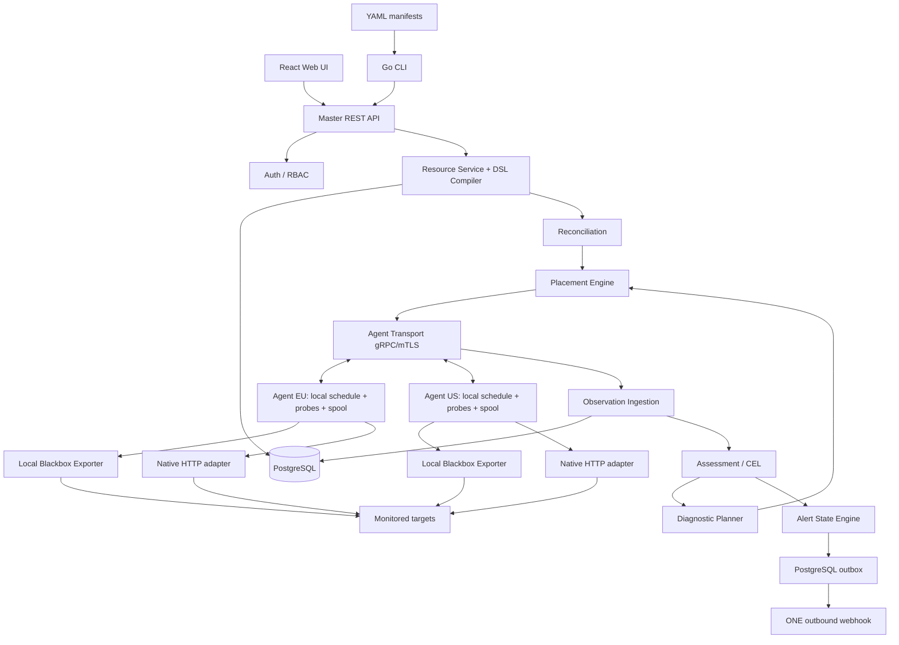

# NetMonOrc — технічне завдання на реалізацію

**Назва:** NetMonOrc (Network Monitoring Orchestration)  
**Ідентифікатор:** NMO-TZ-001  
**Редакція:** 1.0-rc1 — реалізаційний контракт для дослідницького прототипу  
**Дата:** 31 жовтня 2026 року  
**Мова документа:** українська; імена програмних ресурсів, enum та методів API — англійською  
**Основоположна специфікація:** `NetMonOrc_DSL_Schema_v1alpha1.md`, `DSL-SPEC-001`, `apiVersion: netmonorc.io/v1alpha1`  
**Додаток API:** `NetMonOrc_OpenAPI_v1alpha1.yaml` (OpenAPI 3.1)  
**Статус:** документ для початку розробки після фіксації редакції в Git. **Це вимоги до майбутнього ПЗ, а не опис уже реалізованих функцій.**

> **Нормативний пріоритет.** (1) `DSL-SPEC-001` визначає точні назви, типи, defaults і валідацію **публічного YAML DSL**; (2) це ТЗ визначає життєвий цикл, алгоритми, UX, CLI, API та нефункціональні властивості; (3) OpenAPI-додаток задає машинозчитуваний контракт **HTTP API**. У разі виявлення суперечності вона повинна бути вирішена через ADR та одночасну редакцію документів **до реалізації**, а не прихованою поведінкою коду. Усі наведені нижче API-маршрути є новою проєктною специфікацією, а не обіцянкою сумісності з Kubernetes або Prometheus API.

---

## 1. Призначення, результат і межі

### 1.1. Концепція

NetMonOrc — система **Monitoring as Code** для декларативного створення й оркестрації активного комплексного моніторингу сервісів корпоративної мережі. Адміністратор описує у YAML контрольовані цілі, регулярні перевірки, точки спостереження, контекстні залежності, правила оцінювання стану й дозволену додаткову діагностику. **Master/Controller** компілює конфігурацію та керує її розгортанням; **Agent** локально виконує призначені перевірки через готові exporters і типізовані runners; Controller отримує докази, формує зональні й підсумкові стани, запускає обмежену діагностику та генерує алерти, які доставляються через **один вихідний webhook**.

**Користувацька задача:** відрізняти недоступність сервісу, недоступність із певної мережевої зони та втрату самої точки спостереження; зменшувати надлишкові додаткові probes, не погіршуючи істотно якість діагностичного висновку.

**Поняття комплексності у цьому проєкті:** поєднання (а) різнорідних мережевих checks — ICMP, TCP, DNS, HTTP(S), (б) кількох точок/зон, (в) актуальних та простежуваних доказів, (г) контекстних ресурсів і залежностей, (ґ) користувацьких ваг/правил, (д) бюджетованого уточнення несправності. Це **не** повний аналіз користувацького трафіку, SIEM, CMDB усієї організації або гарантована локалізація фізичної першопричини.

### 1.2. Обов'язкові результати

| Код | Артефакт | Умова завершеності |
|---|---|---|
| OUT-01 | `netmonorc-controller`, Go | API, auth, resources, compiler, registry, placement, ingestion, assessment, diagnostics, alerts |
| OUT-02 | `netmonorc-agent`, Go | Enrollment, mTLS, локальний scheduler, драйвери, spool, reconnect, ACK/replay |
| OUT-03 | `netmonorc` CLI | Установлення, підключення, auth, validate/plan/apply, керування та діагностика |
| OUT-04 | Web UI | Авторизація; Dashboard, Monitors, Agents, Enrollments, Alerts, Diagnostics, Config, Settings; узгоджено з API |
| OUT-05 | YAML DSL `v1alpha1` | 11 `kind`, закрита схема, registry + validators + compiler + IR; еталонні приклади й негативні тести |
| OUT-06 | Вбудована інтеграція | Blackbox Exporter для ICMP/TCP/DNS/HTTP; `native-http` для bounded body/extraction |
| OUT-07 | Зберігання | PostgreSQL на Master, SQLite/file spool на Agent; міграції, backups та retention |
| OUT-08 | Розгортання | Compose `master` / `agent`; документований bootstrap і реєстрація Agent з одноразовим TTL `20m` |
| OUT-09 | Дослідницький метод | Fixed DAG і adaptive selector, відтворюваний експеримент, метрики якості/вартості |
| OUT-10 | Документація | README, deployment, ADR, DSL, API/OpenAPI, схеми, troubleshooting, тестові сценарії |

### 1.3. Поза обсягом `v1alpha1`

Централізований збір логів, `LogPipeline`, SIEM, аналіз NetFlow/PCAP, універсальний SNMP-конфігуратор, самостійна TSDB, Kubernetes, Kafka/Redis, автоматичне виконання shell, повноцінний HA Controller, GitOps auto-sync, multi-tenant ізоляція, довільні сторонні plug-ins із YAML, повний конструктор DAG у Web UI, декілька alert-webhook destinations, ML і заявлена ймовірність несправності без калібрування. `Component.spec.mode` дозволяє лише `external`; Compose-інсталяція підготовлює exporter, але `Monitor apply` не інсталює контейнерів.

### 1.4. Вимоги зі статусом

- **MUST** — обов'язкова поведінка дослідницької версії; її тестують.
- **SHOULD** — рекомендована реалізація, відхилення вимагає ADR.
- **MAY** — розширення поза приймальним мінімумом.
- **MVP** — перший робочий наскрізний сценарій. **Research Release** — той самий продукт із реалізованим і перевіреним adaptive-методом.

---

## 2. Архітектура та технологічні рішення

### 2.1. Логічна схема



### 2.2. Процеси/контейнери

| Хост | Процес або контейнер | Технологія | Функція | Межа довіри |
|---|---|---|---|---|
| Master | `controller` | Go (модульний моноліт) | REST, gRPC, DSL, обчислення, delivery | Керування та класифікація |
| Master | `web` | React + TypeScript, Vite build | UI, робота виключно через REST | Не має доступу до БД або секретів агента |
| Master | `postgres` | PostgreSQL, pinned release | Desired/assigned/applied, результати, auth, outbox | Внутрішня Compose-мережа |
| Master | `reverse-proxy` | Caddy або Nginx, pinned release | HTTPS для UI/API, TLS для enrollment/agent ingress за обраною маршрутизацією | Публічна точка входу |
| Agent | `agent` | Go | mTLS, local schedule, drivers, spool | Мінімальні права, лише дозволені цілі |
| Agent | `blackbox` | Prometheus Blackbox Exporter, перевірена pinned версія | ICMP/TCP/DNS/HTTP | Приватна Docker-мережа, `NET_RAW` тільки за потреби |
| Agent | persistent volume | SQLite/файли | Last valid configuration, identity, spool | Файлові права власника |

**Технологічні інваріанти:** Docker Compose розгортає стек тільки на поточному хості; агент реєструється **після** локального встановлення на його VPS. На Agent **не** запускається PostgreSQL. Exporter-порти не публікуються назовні. Для мережевого доступу до цілей потрібна перевірена схема контейнерної маршрутизації; private VLAN/VPN і географічне розміщення задаються в конфігурації стенда. Docker Engine не надається Controller як довільний віддалений Docker socket.

### 2.3. Технічний стек (рекомендований для фіксації в lockfiles)

| Шар | Стек / реалізація | Причина |
|---|---|---|
| Backend | Go; `chi` для REST; `grpc-go`, Protobuf; `pgx`/`sqlc` | Типізація, один виконуваний Core, контроль транспортних контрактів |
| YAML | Go YAML decoder + registry + versioned JSON Schema + semantic validators | Розширення DSL без розростання центрального parser |
| Умови | CEL, Go `cel-go`, compile-time type checking + runtime cost limits | Без виконання довільного коду |
| Regex | Go `regexp` / RE2-подібна семантика | Лінійна поведінка патернів, bounded input |
| Зберігання | PostgreSQL на Master, SQLite WAL на Agent | Durable desired state, idempotent observations, локальна черга |
| UI | React, TypeScript, router, typed API client | Єдина семантика через Controller API |
| CLI | Go + Cobra | `install/agent/config/diagnostics/...` |
| Probes | Blackbox Exporter + bounded `native-http` | Без повторної реалізації основних протоколів |
| Dev/test | `go test`, integration Compose, network namespaces, `tc netem`, сценарії fault injection | Повторювані вимірювання |
| Документація | Markdown + OpenAPI 3.1 | ТЗ як контракт, а не лише опис |

Версії продуктів і Docker image digests фіксуються у release lockfile в репозиторії, а не в цьому концептуальному ТЗ; CI має перевіряти реальну сумісність закріплених версій.

### 2.4. Програмні модулі Controller

| Go-пакет | Вхід → вихід | Відповідальність; що **не** робить |
|---|---|---|
| `api` | HTTP JSON → service calls | DTO, middleware, pagination, error map; не пише SQL у handlers |
| `auth` | credentials/session → principal | Argon2id, RBAC, CSRF, API tokens, audit; не керує агентськими сертифікатами |
| `enrollment` | invite/token/CSR → agent identity | TTL, одноразовість, CA, mTLS identity; не вважає IP постійною ідентичністю |
| `resources` | declarative objects → desired revisions | CRUD, version, references, optimistic concurrency |
| `dsl` | YAML/JSON → compiled IR | Registry, schema, semantic checks, CEL compile, profile expansion |
| `graph` | normalized checks/refs → DAG/adjacency | Dependency edges, cycle detection, topological order |
| `registry` | signed heartbeats → agent state | Capabilities, labels, zones, runner health, online/offline |
| `placement` | checks × eligible agents → assignments | Safety feasibility, zone distinctness, leastLoaded/fixed/roundRobin |
| `reconcile` | desired + applied → config delivery | Desired/assigned/applied, safe rollout, status; не змінює стан цільових серверів |
| `agenttransport` | gRPC frames ↔ agent sessions | mTLS channel, backpressure, task dispatch, acknowledgments |
| `ingestion` | ObservationBatch → stored observations | Provenance, idempotency, durable commit, async state update |
| `assessment` | current evidence + policy → Zone/MonitorAssessment | Freshness, rules, weights, coverage, evidence; не підміняє cause proof |
| `diagnostics` | trigger + hypotheses + actions → task/session | Fixed DAG або adaptive selector, budgets, stop reasons |
| `alerting` | assessments + AlertRule → alert transitions | pending/firing/resolved, cooldown, suppression of old replay |
| `notifications` | outbox event → webhook delivery | Retry/backoff, bearer за secretRef, event_id для дедуплікації, один endpoint |
| `storage` | repositories/transactions → PostgreSQL | SQL, migrations, pooling, retention, backup tooling hooks |
| `audit` | security/resource mutation → AuditEvent | Активності адміністраторів, без секретів і raw HTTP bodies |

### 2.5. Програмні модулі Agent

| Go-пакет | Логіка | Перевірка коректності |
|---|---|---|
| `bootstrap` | Отримує server URL, перевіряє TLS, надсилає одноразовий token + CSR | Нетокенізоване з'єднання не реєструє Agent |
| `identity` | Persistent key/cert, rotation, revocation behavior | Ключ зберігається лише на Agent |
| `connection` | Вихідний gRPC stream; heartbeat; exponential reconnect+jitter | Після network partition коректно відновлює канал |
| `config` | Validate assigned plan; atomic last-known-good; ACK revision | Непридатний plan не замінює застосований |
| `localscheduler` | Periodic checks, jitter, protected baseline slots | Немає потоку RPC на кожний регулярний інтервал |
| `runner` | Registered `blackbox`/`native-http` executors | Не виконує довільний shell із YAML |
| `policy` | Target allowlist, CIDR, resolved IP, redirect checks, resource ceilings | Заборонений фактичний endpoint не досягається |
| `spool` | Durable SQLite outbox, stable IDs, ACK-driven deletion | At-least-once, bounded disk, replay rate limit |
| `health` | Capabilities, runner health, backlog stats | Exporter failure ≠ service failure |

### 2.6. Go-інтерфейси (логічні, до деталізації пакетів)

```go
// Регістри розділені: DSL-ресурси ≠ мережеві виконавці.
type DSLResourceDefinition interface {
    Key() ResourceKey              // apiVersion, kind
    Schema() []byte
    ValidateSemantic(context.Context, ResourceView) []Diagnostic
    Compile(context.Context, ResourceView) (CompiledResource, error)
}

type ProbeDriver interface {
    Type() ProbeType
    Supports(ProbeSpec) bool
    Validate(ProbeSpec) error
    Execute(context.Context, ProbeRequest) (ProbeResult, error)
}

type PlacementEngine interface {
    Place(ctx context.Context, checks []CompiledCheck,
          agents []AgentView, policy PlacementSpec) (PlacementPlan, error)
}

type AssessmentEngine interface {
    Evaluate(ctx context.Context, monitor CompiledMonitor,
             observations []Observation) MonitorAssessment
}

type DiagnosticPlanner interface {
    Next(ctx context.Context, s DiagnosticContext) (Decision, error)
}
```

Ці інтерфейси є **контрактами відповідальності**, не обов'язковими буквально Go-сигнатурами. Їх уточнюють під час проєктування структур, не змінюючи зовнішню YAML/API-семантику. Новий тип ресурсу реєструє власні схему та компілятор; новий драйвер реєструє capabilities і типізовану конфігурацію. Загальний parser не містить `switch` на всі параметри нових probes. Невідомі поля відхиляються; подальше розширення вводиться версіонуванням і заздалегідь визначеними extension points.

---

## 3. Декларативні ресурси та runtime-об'єкти

**Нормативне джерело повних атрибутів — `DSL-SPEC-001`, §1–20, §24.** ТЗ не дублює 1700+ рядків таблиць: це запобігає різним defaults і написанню другого несумісного DSL. Тут визначена поведінка об'єктів у системі.

### 3.1. Публічні `kind` (всі 11)

| `kind` | Власник | Програмна роль | Runtime-наслідок |
|---|---|---|---|
| `Target` | Resource Manager | Контекстний або активний об'єкт цілі; `address`, `networkZone`, `criticality`, attributes | Може залишатися без checks; сам по собі не створює `healthy` |
| `Monitor` | Compiler → Reconciler | Об'єднує target, checks, placement, assessment, diagnostics, dependencies | Генерує план, assignments, observations, assessment |
| `CheckProfile` | DSL Registry | Параметризований набір checks, expansion `${params.x}` тільки для цілого scalar | Ідентифікатори після expansion детерміновані |
| `PlacementPolicy` | Placement Engine | Selectors/agentRefs/zones/replicas/distinctBy/strategy | Призначення, pending/partial coverage |
| `AssessmentPolicy` | Assessment Engine | requiredZones, sameZoneAggregation, freshness, checks weights, CEL, thresholds | ZoneAssessment + MonitorAssessment + Coverage |
| `DiagnosticProfile` | Diagnostic Planner | `mode: fixed|adaptive`, hypotheses, actions, budget | DiagnosticSession/Task із лімітами |
| `AlertRule` | Alert Engine | Scope, when, resolveWhen, severity, for, cooldown, channelRef | Pending/Firing/Resolved, outbox |
| `ResourceGroup` | Group Evaluator | Labels selector; context або derived state | Група не обов'язково моніториться напряму |
| `Dependency` | Dependency Graph | Напрямлений requires-ребро між Target/Monitor | Контекст, а не автоматичний діагноз |
| `Component` | Runner Registry | Тільки `mode: external`, підтримуваний локальний endpoint/exporter | Перевірка доступності runner, без `docker install` під час apply |
| `WebhookEndpoint` | Notifications | Один активний webhook + secretRef, події | HTTP delivery зі статусом і retries |

Вкладені без власного `kind`: `CheckSpec`, `InlineTarget`, `ProfileUsage`, `PlacementSpec`, `ExtractSpec`, `ExecutionFallback`, `AssessmentCheck`, `AssessmentRule`, `FaultHypothesis`, `DiagnosticAction`, `FixedStep`, `AdaptivePolicy`, `DiagnosticBudget`, `GroupEvaluation`, `ResourceReference`.

### 3.2. Операційні об'єкти

`User`, `UserSession`, `ApiToken`, `AgentEnrollment`, `Agent`, `ConfigRevision`, `Assignment`, `Observation`, `ZoneAssessment`, `MonitorAssessment`, `Coverage`, `DiagnosticSession`, `DiagnosticTask`, `Alert`, `NotificationDelivery`, `AuditEvent`, `Operation` існують у БД/API як runtime. Вони **не** можуть створюватися як YAML `kind`. `ApiToken` і `Operation` — внутрішні механізми цього ТЗ для CLI auth/асинхронних `apply`; вони не змінюють декларативну мову.

### 3.3. Зв'язки та пасивні об'єкти

- `Monitor.targetRef` посилається на `Target`; inline `Monitor.target` створює **вбудоване** представлення, а не окремий Target.
- `Target` може мати 0 Monitor; у цьому разі його спостережений стан — відсутній/unknown, а не автоматичний healthy.
- `ResourceGroup` у `mode: context` забезпечує membership/фільтрацію, **не** health; `mode: derived` обчислює стан за вказаною груповою політикою.
- `Dependency` відображає зв'язок `requires`, але не стверджує причинність. Цикли requires заборонено валідатором.
- `Agent` створюється лише enrollment; його `networkZone`, `failureDomain`, permission-relevant labels контролює Master admin, а не самовизначений агент.
- `Check` — шаблон процедури, `Assignment` — конкретне призначення check+agent+revision, `Observation` — один фізичний результат.

### 3.4. DSL-компіляція та застосування

`Decode → Registry lookup(apiVersion,kind) → Schema validation → Resolve refs → Expand profiles → Typecheck CEL/regex → Normalize defaults → IR + Graph → Safety/feasibility → Plan/Diff → Desired revision transaction → Reconcile/Assign → Applied ACK`.

**Інваріанти:** `status`, `metadata.uid/generation/resourceVersion`, passwords, enrollment token, arbitrary shell, недозволені image installs у YAML заборонено. `validate` не вимагає живого агента; `plan/apply` можуть повертати `Pending/Partial` за недоступності online виконавців. `apply` — upsert переданих ресурсів, **не** implicit prune: видалення лише явним DELETE/CLI-командою. Multi-resource apply до desired state — одна транзакція або повністю rollback; застосування на агентах — асинхронне й не атомарне.

### 3.5. Desired/assigned/applied revisions

- `desired_revision`: записана серверна версія ресурсу/плану.
- `assigned_revision`: видана певному агенту версія.
- `applied_revision`: підтверджена агентом локальна версія.
- `accepted` означає збереження desired state; `ready` — усі потрібні агенти підтвердили релевантні assignments. Можливі `pending`, `partiallyApplied`, `outOfSync`, `failed`, `disabled`.
- Зміна `spec` підвищує покоління/версію; читання `status` не створює новий `spec` revision. Старі результати зберігаються історично, але не визначають live Assessment нової ревізії.
- При API-записі `If-Match`/`expectedVersions` захищають від втрати паралельних змін.

---
## 4. Математична модель і технічні алгоритми Go

Наведені формули задають **нормативне обчислювальне значення** алгоритмів у межах v1alpha1. Там, де DSL допускає декілька політик (`all`/`any`, `fixed`/`adaptive`), формули параметризуються відповідним enum; це не обіцянка навчання моделі або імовірнісного fault localization. Усі рішення підлягають порівнянню з тестовими oracle-таблицями. Фізично щільні матриці зберігати не потрібно: Go використовує maps, списки ребер, індекси, adjacency lists.

### 4.1. Множини та матриці, проєкція DSL

Нехай:

- \(R=\{r_1,\ldots,r_n\}\) — `Target`/інлайн цілі й логічні ресурси;
- \(P=\{p_1,\ldots,p_m\}\) — **скомпільовані екземпляри** регулярних checks; профільні ID уже розгорнуті;
- \(A=\{a_1,\ldots,a_k\}\) — довірені агенти;
- \(Z=\{z_1,\ldots,z_s\}\) — мережеві зони, окремо від `failureDomain`;
- \(T=\{t_1,\ldots,t_g\}\) — зареєстровані типи checks;
- \(D\in\{0,1\}^{n\times n}\), \(d_{ij}=1\), якщо \(r_i\) **потребує** \(r_j\); не плутати з автоматично доведеною причиною;
- \(B\in\{0,1\}^{n\times m}\), \(b_{ij}=1\), якщо \(p_j\) пов'язано з \(r_i\);
- \(C\in\{0,1\}^{k\times g}\), \(c_{at}=1\), якщо agent \(a\) підтримує тип \(t\);
- \(U\in\{0,1\}^{m\times g}\), \(u_{jt}=1\), якщо check \(j\) має тип \(t\) (рівно одна одиниця в рядку);
- \(X\in\{0,1\}^{m\times k}\) — призначення перевірок, \(x_{ja}=1\) означає scheduled assignment;
- \(Z_A\in\{0,1\}^{k\times s}\) — відповідність агентів мережевим зонам;
- \(\Lambda\in\{0,1\}^{n\times q}\) — відповідність ресурсів label-селекторам;
- \(W^{(m)}\) — пріоритети **організації** (Check.priority); \(W^{(e)}\) — ваги **оцінювання** (AssessmentPolicy.checks[].weight).

Корисні добутки:

\[
K=BX\in\mathbb N_0^{n\times k},\qquad K_Z=BXZ_A\in\mathbb N_0^{n\times s}.
\]

\(K_{ia}\) — кількість **запланованих** probes ресурсу \(i\) на агенті \(a\); \((K_Z)_{iz}\) — у зоні \(z\). Це не кількість **успішно виконаних** probes і не відсоток coverage. Для контекстного Target рядок \(B\) може бути нульовим; його стан від цього не стає `healthy`.

### 4.2. Формальна допустимість агентського призначення

Визначимо матрицю \(F\in\{0,1\}^{m\times k}\):

\[
 f_{ja}=c_{a,t(p_j)}\,\ell_{ja}\,z_{ja}\,s_{ja}\,r_{ja}\,o_a,
\]

де \(\ell\) — відповідність довіреним labels, \(z\) — політиці zones, \(s\) — локальній target/runner security policy, \(r\) — сумісності runner і параметрів, \(o_a\) — придатність агента до online-призначення. **Невідоме до проби мережеве досягання цілі не можна підставляти як доведену істину:** \(s_{ja}\) означає дозвіл і наявність потрібного способу доступу, а не підтвердження фактичної доступності.

Для кожного check із `replicas = q_j`:

\[
 x_{ja}\leq f_{ja},\qquad 0\leq\sum_{a=1}^{k}x_{ja}\leq q_j.
\]

Якщо `onInsufficientAgents: pending`, неповний набір не оголошується готовим; за `partial` допустимий частковий план з `coverage_degraded`. Для `distinctBy: zone`:

\[
 \sum_{a:\operatorname{zone}(a)=z}x_{ja}\leq 1\quad\forall j,z,
\]

аналогічно для `failureDomain`. Для `fixed` вибір обмежений `agentRefs`. Для `leastLoaded` вибираються допустимі агенти з найменшим відносним завантаженням \(u_a=\text{running}_a/\max(1,\text{capacity}_a)\); наступний вибір перебуває в тій самій feasible множині. Tie-break — стабільний `agentID ASC`; `roundRobin` використовує стійкий покажчик на рівні policy. **Безпекові умови — hard constraints, не штрафні ваги.**

За потреби задача планування зі зваженим пріоритетом може розглядатися як:

\[
 \max_X\ \sum_{j,a}p_jx_{ja}-\lambda\sum_a\max(0,u_a-u_{\max})^2
\]

за наведених hard constraints, де \(p_j=\mathrm{Check.priority}_j/100\). Але **реалізація v1alpha1 не зобов'язана розв'язувати глобальну integer optimization**: визначеним алгоритмом є filter → deterministic `leastLoaded`/`fixed`/`roundRobin` → coverage-status. Критичність Target може використовуватися лише як **задокументований вторинний tie-break**, а не неявно змінювати `priority`. Це не дає помилково ототожнювати \(W^{(m)}\) і \(W^{(e)}\).

**Оцінка складності MVP:** фільтрація `m` checks по `k` агентах коштує \(O(mk)\) перевірок умов (без урахування lookup індексів, сортування й мережевих запитів); sort candidates — до \(O(mk\log k)\). Рішення зберігається у `Assignment` із revision, zone і failureDomain.

### 4.3. Локальне планування й час виявлення

Для регулярного check \(j\) із початком \(t_0\), інтервалом \(I_j\), jitter \(\xi_{jn}\) в дозволених DSL межах:

\[
 t_{j,n}=t_0+nI_j+\xi_{j,n},\qquad 0\leq\xi_{j,n}\leq I_j/4.
\]

У `v1alpha1` **default jitter = 0**; жоден неоголошений jitter не додається в YAML-значення. Для одночасних стартів рекомендується контрольований scheduler-level backpressure, який фіксує реальний start lag. \(\mathrm{timeout}_j<I_j\). Якщо задача не вміщується у concurrency budget, запуск пропускається/затримується за явною політикою з telemetry counter, але **не запускається необмежена черга**. Priorities — для дефіциту слотів; baseline отримує зарезервовані ресурси окремо від diagnostics.

Для сталого збою, за відсутності network jitter і при виявленні лише на черговому check, очікуваний час первинного виявлення лежить приблизно в межах від 0 до \(I_j+\mathrm{timeout}_j\) після збою (без урахування затримки доставки). Це **аналітична верхня оцінка за припущень**, а не SLA. Підтвердження `for`, потреба в декількох послідовних результатах та втрати зв'язку збільшують час до firing.

### 4.4. Канонічне спостереження та придатність доказів

Сирий результат агента зберігається як `Observation` зі стабільним `observationID`, `monitorID/checkID`, `agentID`, `networkZone`, `failureDomain`, `configRevision`, фактичним `startedAt/finishedAt`, `receivedAt`, `executionStatus`, `probeOutcome`, `reasonCode`, duration, типізованими values і `diagnosticSessionID/taskID` за потреби. Агентська identity береться з **mTLS principal**, не довіряється полю в JSON/Protobuf. Clock timestamps — UTC, duration — monotonic clock.

Для \(p_j\), агента \(a\), моменту оцінювання \(t\) введемо придатність:

\[
 v_{ja}(t)=\mathbf1[\text{completed/valid probe}]\cdot
 \mathbf1[\text{revision=current applied}]\cdot
 \mathbf1[0\leq t-t_{\mathrm{finish}}\leq\tau_j]\cdot
 \mathbf1[|\Delta\mathrm{clock}|\leq\delta_{\max}].
\]

Тут \(\tau_j=\text{freshness.maxAge}\) або DSL default (§9.2), \(\delta_{\max}\) — діагностований поріг невизначеності часової синхронізації, **не підміняти** його `freshness.maxSkew` (останній — максимальний інтервал між порівнюваними probes). Для `maxSkew` в одному cross-check наборі \(E\) додатково необхідно:

\[
 \max_{e\in E}t_e-\min_{e\in E}t_e\leq\mathrm{freshness.maxSkew}.
\]

Поточний `probeOutcome` формує проєкцію \(h_{ja}\in\{0,1,\bot\}\): `success`→1, підтверджений `failure`→0, технічна неможливість/відсутність→\(\bot\). HTTP 503 за завершеного запиту — negative outcome; непрацюючий exporter — `execution_failed`, outcome unavailable; TCP timeout цілі — negative або ambiguous згідно контракту check, не `agent_failed`. Extraction `unknown` не дорівнює числу 0.

Якщо дані отримано через replay, вони можуть бути збережені, але **не** створюють live-state заднім числом, якщо вже є новіші/іншоревізійні докази. Для діагностичних порівнянь задається достатня часова синхронність; за браку її стан стає incomplete/unknown.

### 4.5. Агрегація кількох агентів усередині зони

Нехай \(A_{jz}\) — набір запланованих агентів check \(j\) у зоні \(z\), \(V_{jz}(t)=\{a\in A_{jz}:v_{ja}(t)=1\}\). Два supported режими з `AssessmentPolicy.sameZoneAggregation`:

\[
 h_{jz}^{\mathrm{all}}=
 \begin{cases}
 1,&V\neq\varnothing\ \land\ \forall a\in V:\ h_{ja}=1,\\
 0,&V\neq\varnothing\ \land\ \exists a\in V:\ h_{ja}=0,\\
 \bot,&V=\varnothing,
 \end{cases}
\]

\[
 h_{jz}^{\mathrm{any}}=
 \begin{cases}
 1,&V\neq\varnothing\ \land\ \exists a\in V:\ h_{ja}=1,\\
 0,&V\neq\varnothing\ \land\ \forall a\in V:\ h_{ja}=0,\\
 \bot,&V=\varnothing.
 \end{cases}
\]

`sameZoneAggregation=all` default, `any` — лише явне рішення. Якщо деякі заплановані агенти не надали свіжих доказів, отриманий outcome **не** заповнює відсутній coverage; додається `coverage_degraded`. Протилежні результати — `AGENT_RESULTS_DIVERGE`, усі observation IDs зберігаються. Така агрегація не створює хибної незалежності: агентські `failureDomain` враховують окремо.

### 4.6. Ваги, coverage, оцінка стану та CEL

Для конкретного Monitor \(i\) у зоні \(z\): \(b_{ij}\) визначає належність check ресурсу, \(w_{ij}^{(e)}\geq0\) — вага AssessmentCheck, \(m_{ij}\in\{0,1\}\) — його обов'язковість, \(v_{ijz}=\mathbf1[h_{jz}\neq\bot]\), \(h_{ijz}\in\{0,1\}\) — підтверджений outcome. Нормуємо \(\sum_jb_{ij}w_{ij}^{(e)}=1\). **Вага виконання `Check.priority` тут не використовується.**

\[
 Q_{iz}(t)=\frac{\sum_j b_{ij}w^{(e)}_{ij}v_{ijz}(t)}{\sum_jb_{ij}w^{(e)}_{ij}},
 \qquad
 H_{iz}(t)=\frac{\sum_jb_{ij}w^{(e)}_{ij}v_{ijz}(t)h_{ijz}(t)}{\sum_jb_{ij}w^{(e)}_{ij}v_{ijz}(t)}.
\]

Коли знаменник \(H\) дорівнює 0, \(H=\bot\) і зональний стан не може бути `healthy`. \(Q\) — частка **актуальної зваженої інформації**, \(H\) — успішність **наявних** спостережень, **не** ймовірності. Якщо \(H=1, Q=0.4\), загальне `healthy` не підтверджене (DSL default minCoverage 1). У DSL `required` — hard gate:

\[
 \mathrm{RequiredOK}_{iz}(t)=\bigwedge_{j:m_{ij}=1}\left[v_{ijz}(t)=1\ \land\ h_{ijz}(t)=1\right].
\]

Для всіх checks, які оцінюються одночасно, потрібні сумісні revisions та `maxSkew`; інакше \(Q\)/`coverage` зменшується, CEL отримує `unknown` і не може підтвердити healthy. Відсутні required checks не компенсуються високими вагами. Для `AssessmentPolicy.rules`: `priority DESC, id ASC`, перше **істинне** правило є кандидатом; `unknown/evaluation_error` фіксується й не трактується як `false` для дозволу здорового стану. Якщо match відсутній, застосувати пороги `weighted.healthyMin/degradedMin` або `defaultState` згідно DSL. Після обчислення — **інваріант**:

\[
 S_{iz}=\mathrm{healthy}\ \Longrightarrow\
 \left[Q_{iz}\geq Q_{\min}\right]\land\mathrm{RequiredOK}_{iz}\land\mathrm{FreshRevisionConsistent}_{iz}.
\]

Порядок `down/degraded/unknown` визначається підтвердженими CEL-правилами та weighted fallback; навіть коли загальний coverage неповний, фактичний failure може зберігати локальний `down` **разом** із `coverage_degraded`. `unknown` і execution failure не перетворюються на `down` автоматично.

Зональні стани агрегуються за `zoneAggregation`:

- `all-required` (default): `healthy` лише коли **всі** required zones підтверджено здоровими; failure однієї required zone не приховується успіхом інших. Для суперечливих зон загальний стан `degraded`/`down` задається DSL assessment policy; необхідні зональні дані лишаються в API.
- `any`: тільки за явно встановленого SLA «сервіс достатньо доступний хоч з однієї зони»; це **не** voting majority. Інші негативні зони все одно показуються й можуть мати alerts `scope: zone`.
- Відсутня потрібна зона → `coverage_degraded`, зона `unknown`; не виставляти global healthy, якщо для нього немає достатніх підстав.

**Детермінована таблиця агрегування за зонами** (стан і coverage — окремі результати; `failure` застосовується лише до актуального доказу):

| Умови в потрібних зонах | `all-required` | `any` | Coverage |
|---|---|---|---|
| Усі required зони `healthy` | `healthy` | `healthy` | `sufficient` за потрібних checks/replicas |
| Є `down` і хоча б одна `healthy`; жодна зона `unknown` | `degraded` | `healthy` | `sufficient` за наявних потрібних доказів; зони зберігаються |
| Усі required зони `down` | `down` | `down` | `sufficient` лише за наявних усіх потрібних доказів |
| Немає `down`, є `degraded`; усі зони відомі | `degraded` | `degraded`, якщо немає `healthy` | Залежить від повноти доказів |
| Є `unknown`, усі інші `healthy` | `unknown` | `healthy`, якщо any-one-zone SLA допускає | `degraded` |
| Є `unknown` і хоча б одна доведена `down`, немає `healthy` | `degraded` (доведено локальну проблему, але не повну відмову) | `degraded` | `degraded` |
| Усі required зони `unknown` | `unknown` | `unknown` | `unknown`/`degraded` за причиною |

Якщо є змішані `healthy/degraded/unknown`, `all-required` повертає `degraded`, якщо є підтверджений `degraded`, інакше `unknown`; `any` повертає `healthy`, якщо здорової зони за його SLA достатньо. **Не можна** автоматично підвищити global `healthy`, якщо потрібна локальна required check не пройшла; `any` є свідомим винятком до вимоги «усі required зони здорові» за визначенням такого SLA. Повнота даних і обов'язковість checks оцінюються окремо в кожній зоні. Така таблиця конкретизує `zoneAggregation` без нового DSL-поля.

Псевдокод для `Evaluate`:

```text
for zone in requiredZones ∪ assignedZones:
    select latest valid observations by check×agent×current revision
    aggregate same-zone assigned agents using configured all/any
    compute temporal/coverage flags, Q and H
    evaluate CEL rules by priority; fallback to weighted/default
    apply healthy safety gates; attach evidenceIDs, reasonCodes
aggregate zone states using zoneAggregation
persist assessment + coverage transactionally
emit state-change event (not raw replay) for alerts/diagnostics
```

**Вартість** грубо \(O(M_z\cdot K_z+N_r)\) для одного Monitor при індексованому завантаженні останніх observations; фактичну латентність перевірити навантажувальним тестом. CEL-обчислення обмежене cost budget, входи типізовані; `missing` не дорівнює false/zero за умовчанням.

### 4.7. Похідні `ResourceGroup` і граф залежностей

Для labels/selector матриця \(\Lambda_{ig}=1\) iff Monitor/Target задовольняє selector \(g\). Група `mode: context` **не має** health-score. Для `mode: derived` групова політика (точні поля §16 DSL) обчислює агрегований стан за **наявними** MonitorAssessment; критичні/required members не можуть бути приховані довільними вагами, unknown позначається окремо. Якщо задано ваговий режим групи, ілюстративна числова проєкція:

\[
 H_g=\frac{\sum_{i\in M_g} \omega_i v_i h_i}{\sum_{i\in M_g}\omega_i v_i},\qquad
 Q_g=\frac{\sum_{i\in M_g}\omega_i v_i}{\sum_{i\in M_g}\omega_i},
\]

де \(h_i\) — **лише визначене груповою політикою** представлення стану, не автоматична властивість фізичного сервісу. Обов'язковість і minCoverage застосовуються окремо. `Dependency` і матриця \(D\) дають контекст під час групування/діагностики; правило `r_i depends on r_j` **не** означає `failure(r_i) ⇒ failure(r_j)`.

### 4.8. Fixed diagnostic DAG

Для `mode: fixed` визначаємо \(G_d=(V_d,E_d)\), де вузол — `FixedStep`, ребро \(u\to v\) iff `v.dependsOn` містить `u`. Семантичний валідатор відхиляє цикли. Доступний до запуску крок \(v\), якщо:

\[
 \mathrm{Ready}(v)=\bigwedge_{u\in\mathrm{pred}(v)}\mathrm{Terminal}(u)
 \land\ \mathrm{CELwhen}_v=\mathrm{true}
 \land\ \mathrm{WithinBudget}(v).
\]

`unknown/error` CEL не запускає крок і залишає пояснення в сесії. Незалежні кроки можуть запускатися паралельно не вище `budget.maxParallel` та системних лімітів; physical attempts, включно з retry/fallback, враховуються в `maxAdditionalChecks`. Одна активна сесія на Monitor/incident episode; `cooldown` після завершення.

### 4.9. Adaptive: алгоритм розрізнюваності гіпотез на одиницю вартості

Каталог \(\mathcal H=\{h_1,\ldots,h_d\}\) — класи **спостережуваних** несправностей, а не фізичні причинні твердження. Після кожного результату існує набір ще сумісних гіпотез \(\mathcal H_t\). Дозволені дії \(\mathcal U\) — `DiagnosticProfile.actions`; конкретний кандидат — пара \(u=(\mathrm{action},\mathrm{agent})\), що задовольняє capability, zone, target policy, deadline, global/per-target limits. `expectedOutcomes` визначають для кожного \(h\) допустиму множину \(S_{u,h}\subseteq\{\mathrm{success},\mathrm{failure},\mathrm{unknown}\}\):

- `success` → \(\{success\}\), `failure` → \(\{failure\}\), `unknown` → \(\{unknown\}\);
- `either` → усі три можливості. **Це таблиця експертних патернів, а не калібрована ймовірнісна модель.**

Дві гіпотези розрізнювані дією \(u\), якщо множини можливих результатів не перетинаються:

\[
 \delta_u(h_p,h_q)=\begin{cases}1,&S_{u,h_p}\cap S_{u,h_q}=\varnothing,\\0,&\text{інакше}.\end{cases}
\]

\[
 G(u\mid\mathcal H_t)=\sum_{p<q:\,h_p,h_q\in\mathcal H_t}\delta_u(h_p,h_q),\qquad
 \mathrm{Score}(u)=\frac{G(u\mid\mathcal H_t)}{\mathrm{costUnits}(u)}.
\]

Вибираємо допустиму пару з найбільшим score; tie-break **`actionId ASC`**, потім стабільний `agentID ASC` (останнє — внутрішня детермінізація, не новий DSL enum). Якщо `Score=0` для всіх кандидатів — немає інформативного кроку: завершити `inconclusive` або виконати лише явно дозволені `maxNoGainSteps` за профілем. Ціна й гіпотези формуються до випробувань, не з ground truth окремого тесту.

Після результату \(y_t\) оновлення:

\[
 \mathcal H_{t+1}=\{h\in\mathcal H_t:\ y_t\in S_{u,h}\}.
\]

Технічний `execution_failed` **не є** підтвердженням жодної сервісної гіпотези; зазвичай не звужує \(\mathcal H_t\). Якщо множина стала порожньою, це означає конфлікт патернів/доказів, а не «жодна причина»: завершити `inconclusive` із `EVIDENCE_CONFLICT`. Один нестабільний probe не виключає гіпотези остаточно без відповідної моделі шуму/повторів; для MVP використовувати експертні `either`/limited confirmation, а не неіснуючі posterior probabilities.

Підстави завершення: \(|\mathcal H_t|=1\) за достатніх доказів; немає інформативних дій; вичерпано maxChecks / maxDuration / estimatedBytes; конфлікт спостережень; відсутні допустимі агенти. `completed` ≠ доведена фізична першопричина; `inconclusive` — коректна й обов'язкова можливість.

**Бюджети:** нехай \(N_t\) — число додаткових **фізичних** спроб, \(T_t\) — elapsed time, \(P_t\) — current parallelism, \(\widehat B_t\) — оцінені додаткові байти. Перед dispatch:

\[
 N_t+\widehat n(u)\leq N_{\max},\quad
 T_t+\widehat\tau(u)\leq T_{\max},\quad
 P_t+\widehat p(u)\leq P_{\max},\quad
 \widehat B_t+\widehat b(u)\leq B_{\max}\ (\text{якщо задано}).
\]

Секунди, байти й кількість запусків **не додаються** без нормування. `maxAdditionalChecks` — тверда межа physical attempts; estimated bytes — окреме soft/estimated обмеження, реальний трафік вимірюється в експерименті. Оцінка перебору кандидатів \(O(|\mathcal U|\,k\,|\mathcal H_t|^2)\) на вибір до optimizations/caching.

### 4.10. Алертинг як автомат станів

Для `AlertRule` над scope `monitor` або `zone`:

- `normal → pending`, якщо `when=true`;
- `pending → firing`, якщо умова **безперервно** істинна упродовж `for`; для `for=0s` — без затримки (але після доставки/оцінювання);
- `pending → normal`, якщо визначено `when=false` до завершення часу; `unknown` **перериває підтвердження безперервності**, не створюючи новий firing;
- `firing → resolved`, якщо `resolveWhen=true`; `unknown` не є ознакою відновлення;
- `resolved → pending/firing` за нової незалежної умови та cooldown/dedup policy.

Унікальний logical alert key: `(ruleUID, monitorUID, scope, zone-or-null)`; delivery event ID унікальний **для зміни стану**, тому webhook receiver може дедуплікувати повтори. Outbox доставляється щонайменше один раз, retry використовує exponential backoff, обмеження спроб/TTL, не змінює Alert.state від помилки webhook. Один `WebhookEndpoint` активний. Старі replay observations не генерують live alert flood.

### 4.11. Надійна доставка спостережень і операцій

- Кожен фізичний probe attempt отримує **стабільний** Observation ID, який не змінюється під час replay.
- Agent локально записує payload у persistent spool, потім передає batch.
- Controller у транзакції робить `INSERT ... ON CONFLICT (observation_id) DO NOTHING`, прив'язує authenticated agentID, перевіряє revision/provenance та **лише після COMMIT** підтверджує batch ACK.
- Agent видаляє підтверджені записи, не вважаючи ACK гарантією `exactly-once execution`.
- Нехай \(N_{\mathrm{sent}}\) — кількість різних observation IDs, \(N_{\mathrm{stored}}\) — durable unique IDs: після успішного replay й без overflow \(N_{\mathrm{stored}}=N_{\mathrm{sent}}\). Duplicate delivery допустимий, duplicate **records** — ні.
- При spool overflow застосовується документована deterministic eviction-policy + `spool_dropped_total`; ніколи не оголошувати дані повними після втрати.
- Поточні observations мають пріоритет над довгим replay; lateness/clock skew і перехід між config revisions не повертають live-state у минуле.

### 4.12. Експериментальна перевірка математичного методу

Режими: **A** — baseline fixed regular/static diagnostics; **B** — якісний фіксований conditional DAG; **C** — adaptive selector із тим самим action catalog. Для всіх однакові trigger, agents/zones, budgets, timeout, ground truth і початкові спостереження. Окремий додатковий контроль — random/round-robin при тому самому бюджеті. Алгоритми не бачать fault injection log. Рекомендується абляція `fixed agent + adaptive action` проти `adaptive action + agent`.

Позначення вимірювань: \(TP_c,FP_c,FN_c\) для класу \(c\); \(N_\mathrm{episodes}\) — число незалежних інцидентних запусків; \(N_\mathrm{conclusive}\) — кількість визначених діагностичних висновків.

\[
 \mathrm{Precision}_c=\frac{TP_c}{TP_c+FP_c},\quad
 \mathrm{Recall}_c=\frac{TP_c}{TP_c+FN_c},\quad
 F1_c=\frac{2P_cR_c}{P_c+R_c},\quad
 \mathrm{MacroF1}=\frac1{|\mathcal C|}\sum_cF1_c.
\]

За нульового знаменника відповідний показник позначається `undefined` і окремо обліковується за затвердженим протоколом, а не непомітно прирівнюється до 100%. **Coverage діагностичних висновків**:

\[
 \mathrm{ConclusiveRate}=\frac{N_{\mathrm{conclusive}}}{N_{\mathrm{episodes}}},\qquad
 \mathrm{InconclusiveRate}=1-\mathrm{ConclusiveRate}.
\]

Час \(T_{\mathrm{detect}}=t_{\mathrm{first\ trigger}}-t_{\mathrm{fault}}\) **окремо** від \(T_{\mathrm{diagnose}}=t_{\mathrm{terminal\ conclusion}}-t_{\mathrm{first\ trigger}}\); подавати median, p95 та distribution. Ціна \(\mathrm{ProbeCount}=\sum_u\mathrm{physicalAttempts}(u)\) включає retry/fallback; окремо CPU/RAM, байти запитів/відповідей, порушення бюджету. Повтором експерименту є **один окремий інцидент**, а не кожен probe в ньому. Тестувати нормальну роботу, HTTP 500, DNS failure, TCP listener down, partial zone block, shared dependency, agent/control disconnect, stale/duplicate/reordered delivery, unknown/multiple faults. Протокол повторів/довірчих інтервалів та умови користі мають бути зафіксовані **до** фінального тесту; жоден виграш не стверджується наперед.

---
## 5. Наскрізні життєві цикли та безпека

### 5.1. Розгортання й bootstrap Master

Одна release-збірка постачає дві **взаємовиключні** локальні ролі Compose: `master` та `agent` (допускаються два compose-файли, які wrapper вибирає за `--role`). Команди: `netmonorc install --role master` та `netmonorc install --role agent`. Установлювальний shell-wrapper — рекомендована обгортка, яка перевіряє Docker Engine + Compose, обирає release manifest, створює persistent каталоги, volumes і перевіряє порти/health, але не дозволяє запуск довільних неперевірених Docker-образів із Monitor YAML. Усі образи — pinned verified release/digest.

**Початкова інсталяція Master:** preflight → secure local config → створення/підключення HTTPS trust (public CA або власний CA із out-of-band fingerprint) → запуск PostgreSQL та міграцій → інтерактивний bootstrap admin username/password → старт Controller/Web/reverse-proxy → readiness check → показ master URL. Пароль вводиться без echo, **не** через CLI flags, `argv`, звичайний YAML, `.env` або журнал. У БД зберігається лише **Argon2id password hash з індивідуальною сіллю**. Bootstrap одноразовий ідемпотентний: повторний installer не скидає пароль. Для відновлення admin потрібна окрема локальна recovery-процедура з аудитом; звичайний API не повертає пароль.

### 5.2. Підключення Agent: 20-хвилинне запрошення

**Дії користувача:** (1) на агентському VPS `netmonorc install --role agent`; (2) на Master UI/CLI створити enrollment із назвою, довіреною зоною й необов'язковою очікуваною IP; (3) отримати секретний token, TTL **рівно 20 хвилин** з моменту створення; (4) на Agent `netmonorc agent enroll --server https://master.example` і **ввести токен інтерактивно**; (5) перевірити статус Online/Ready.

**Алгоритм EnrollmentService:**

1. Master створює CSPRNG token (наприклад, UUIDv4 або 256-бітний random), зберігає `H(token)`, одноразовий enrollment ID, `expiresAt=createdAt+20m`, `expectedIP?`, labels/zone, `createdBy`, `consumedAt=null`, status pending; token показується **один раз**.
2. Agent перевіряє TLS-сертифікат Master або pinned CA fingerprint, генерує **локально** пару асиметричних ключів і надсилає `token + CSR + agent software version` на окремий enrollment endpoint. `insecureSkipVerify` заборонено.
3. Master автентифікує URL/сертифікат/формат CSR, rate limits; у транзакції блокує enrollment row, перевіряє `H(token)`, `now<expiresAt`, not consumed/revoked; за наявності `expectedIP` перевіряє **спостережену довіреним reverse proxy адресу**, не довільний `X-Forwarded-For` із клієнта.
4. Master видає `agentID`, короткоживучий клієнтський mTLS certificate із прив'язкою до `agentID`, атомарно витрачає token; записує audit, повертає trust chain і адресу agent service. Для збою між issuance та commit потрібна ідемпотентна безпечна процедура відновлення без повторного видавання довільної ідентичності.
5. Agent зберігає приватний ключ лише локально, встановлює вихідний mTLS канал, надсилає capabilities/health, після чого отримує assignment.

**IP — не identity:** Agent може працювати за NAT/WireGuard або змінити адресу; `expectedIP` — одноразовий optional restriction, а постійна довіра — cert identity і revocation. Для скомпрометованого Agent адмін виконує revoke; старий cert не повинен продовжувати authorizing нові з'єднання. Перевидавання сертифікатів та закінчення строку дії має окремі протокольні стани `rotation_due`/`certificate_expired`; усі секрети зберігаються в restrict-permissions volume. Rate limit/policy на спроби enrollment — обов'язково.

### 5.3. User login і авторизація

Браузер: `POST /api/v1/auth/login`, створення server-side session у PostgreSQL, `Secure; HttpOnly; SameSite` cookie, CSRF захист на мутаціях. `GET /auth/me`, `POST /auth/logout`. Паролі — Argon2id; lockout/rate limiting, журнал невдалих логінів без введених паролів. Ролі: `admin` (керування, enrollment, webhook, config, users), `viewer` (читання; без змін). CLI працює через **особистий API token** (`POST /auth/tokens` через захищену authenticated browser session; CLI `netmonorc login --server ... --token-stdin` або інтерактивне введення), який зберігається локально із захищеними правами; токен на сервері лише у вигляді hash. `Authorization: Bearer ...` для CLI. Можна додати device flow згодом, але його немає у v1alpha1. Agent mTLS ідентичність **не використовує** користувацькі токени.

### 5.4. Застосування Monitor

1. CLI/Web UI надсилає YAML/JSON resource manifest на єдиний backend.
2. DSL registry перевіряє `apiVersion/kind`, closed schema, refs, typed profile expansion, CEL/regex, `type/runner/config`, security boundaries.
3. Compiler формує canonical IR та fingerprint/plan. `POST /config/validate` перевіряє; `/config/plan` повертає diff, колізії, pending placements; `/config/apply` записує **desired** в одній транзакції.
4. Reconciler призначає checks, формує **per-agent** assigned configuration; agent локально перевіряє й атомарно застосовує; повертає `appliedRevision`.
5. Коли частина агентів офлайн, стан `Pending/PartiallyApplied/OutOfSync`; немає удаваної атомарності між VPS.
6. Зміни `spec` формують нову revision; висновок поточного Monitor не бере старі evidence як нові. Видалення ресурсу із refs без попереднього звільнення зв'язків повертає `409 RESOURCE_REFERENCED`.

### 5.5. Регулярні перевірки й діагностика

- Local Scheduler виконує **тільки** назначені й дозволені базові checks із локальної last-known-good revision.
- Blackbox Exporter виконує стандартні probes; `native-http` використовується лише коли потрібні body extraction/`connectIP` і перевірена підтримка. Один check → **один** фактичний HTTP probe, не прихована пара запитів.
- Agent формує Observation, durable-spool і batch stream. Controller commit+ACK. Assessment змінює zone/monitor state і coverage, Alert Engine оновлює алерти.
- `DiagnosticBinding` запускає fixed/adaptive сесію лише за `onStates`, CEL, cooldown; не більше однієї активної на епізод; бюджет на probe attempts жорстко обмежений.
- Execution fallback лише за технічної **неможливості виконати** на виконавці; success іншої зони — нова perspective, не непомітна заміна потрібної зони.

### 5.6. Controller outage, replay та відновлення

Agent продовжує останні дозволені scheduled checks, накопичує результати до межі persistent spool, повідомляє про втрати після reconnect. У цей період **не** працюють централізовані оцінювання, нові adaptive sessions, Web UI та outbound webhook. Після reconnect старі події зберігаються для історії, але не перезаписують нові live-стани; replay обмежений за швидкістю та не витісняє current traffic. Master контролюється окремим зовнішнім healthcheck; PostgreSQL backup/restore — обов'язкова експлуатаційна процедура. Переміщення Master на випадковий Agent і вибори master без узгодженого fencing **не підтримуються**.

### 5.7. Основні загрози і захисні умови

| Загроза | Контроль | Тест |
|---|---|---|
| SSRF через Monitor target, DNS rebinding/redirect | Allowlist фактичних IP, CIDR, перевірка на **кожному** redirect і connect; cloud metadata/link-local блоковані за замовчуванням, внутрішні corporate CIDR дозволяються явно | Зовнішній URL redirect у forbidden host блокується |
| Компрометація Agent enrollment | 20m high entropy one-time token, hash at rest, TLS pinning, optional expectedIP, atomic consume, CA/mTLS | Token replay/expiry/revocation відхилені |
| Виконання shell із DSL | Лише зафіксовані typed runners; заборонені shell/bin/config injection | `command: "..."` у маніфесті відхиляється |
| Велике HTTP body / regex / CEL DoS | Per-target/body/response limit, CEL cost budget, Go regexp, timeout | oversized payload та cost-exceed повертають контрольовану помилку |
| Масова несправність і діагностичний шторм | One episode per Monitor, global/agent/target limits, maxChecks/deadline/cooldown | Бюджет не перевищений, baseline продовжується |
| Токени/секрети у config/response | `secretRef` з обмеженою файловою доставкою, redaction, no raw body history | Секретів немає в API GET, logs та DB observations |
| Неавторизоване редагування | RBAC, sessions/API token scopes, If-Match, audit | Viewer одержує 403 на write |
| Втрата або дублювання даних | Persistent spool, durable ACK, stable IDs, unique DB constraint, bounded replay | Після outage немає duplications і неврахованих drop |

---

## 6. Web UI: повна карта можливостей і візуальна система

### 6.1. Кольори й доступність

**Тверді бренд-токени:** `--brand-primary: #2E8B57` (Sea Green), `--canvas: #FDF5E6` (Old Lace). Допоміжні `--text: #1F2933`, `--surface: #FFFFFF`, `--border: #D7DED8`, нейтральні сірі й семантичні warning/error/success/unknown визначає UI theme; не змінювати бренд-токени. `Healthy/Degraded/Down/Unknown/CoverageDegraded` відрізняються **і кольором, і текстом, і піктограмою**; WCAG contrast перевіряти автоматизовано. Desktop-first responsive; малі екрани — readable tables/filters. Заборонено показувати токен enrollment вдруге після закриття модального вікна.

### 6.2. Сторінки, елементи, дії користувачів

| Сторінка | Що бачить `viewer` | Що може `admin` | API |
|---|---|---|---|
| Login | Username, password, session errors | Те саме; recovery тільки з локального хоста | `/auth/login`, `/auth/me` |
| Dashboard | Загальний стан за зонами, алерти, offline agents, coverage, останні diagnostics, version | Перейти до ремонту конфігурації/діагностики | `/dashboard/summary`, `/system/status` |
| Monitors | Список, фільтр за labels, status/coverage/zone, пошук, сортування | Створити через YAML apply; увімкнути/вимкнути в spec, видалити за правилами refs | `/resources/Monitor`, `/config/*` |
| Monitor Details | Checks, required/optional, weights, runner, current revisions, zone assessment, таблиця observations, evidence, diagnostics | Запустити manual diagnostics, перейти до YAML/Policy, видалити з ETag | `/monitors/{name}/*`, `/resources/Monitor/{name}` |
| Targets | Активні/пасивні цілі, адреса, мітки, dependencies | Створити/оновити/видалити ресурс через manifest API | `/resources/Target`, `/resources/Dependency` |
| Agents | AgentID, networkZone, failureDomain, labels, capabilities, cert age, online/runnerHealth, spool stats, assignments | Редагувати **довірені** metadata; revoke; створити запрошення | `/agents`, `/agents/{id}`, `/agents/enrollments` |
| Enrollments | Existing invite status, expiresAt, consumed/revoked | Створити invite, показати token один раз, revoke до використання | `/agents/enrollments*` |
| Alerts | Firing/pending/resolved, severity, rule, zone, cause/evidence, age | Acknowledge, перехід до AlertRule, test webhook | `/alerts*`, `/webhook/test` |
| Diagnostics | Session status/mode, candidate actions, consumed budget, stopReason, evidence, timeline | Manual launch, cancel running session | `/diagnostics/*`, `/monitors/{name}/diagnostics` |
| Configuration | Manifests read-only, specs/status/revisions, валідатор errors/warnings, diff/plan | YAML upload/edit basic text + validate/plan/apply; без visual drag-drop DSL builder | `/resources/*`, `/config/*`, `/operations/*` |
| Resource Groups | labels/member counts, context/derived states, missing data | Змінити групу через YAML | `/resources/ResourceGroup`, `/resource-groups/{name}/assessment` |
| Integrations | Active webhook metadata/delivery history, external Components & health | Налаштувати `WebhookEndpoint` через resource apply/secretRef, test | `/resources/WebhookEndpoint`, `/webhook/*` |
| Settings / Users | Own session, server version/read-only settings | Users/roles, create/revoke CLI tokens, audit, own password change | `/users*`, `/auth/tokens*`, `/audit-events` |

**Функціональні вимоги UI:** UI не містить окремого планувальника або parser: усі формулювання/валідація server-side. Інтерфейс показує одночасно `service state`, `coverage`, `config applied status`; жодне з них не сховане за одним «зелено/червоним» badge. При pending/failed apply показуються помилки на агенті та `desired/assigned/applied`. Історичне replay позначається. Для великих списків — server pagination, пошук і filter, без завантаження всієї таблиці у браузер. Динамічні сторінки у MVP опитуються через REST polling зі збалансованим інтервалом (WebSocket/SSE необов'язкові).

### 6.3. Ролі й доступність дій

- `viewer`: `GET` на основні read-only API; не бачить токенів/паролів/secretRef значень, не виконує `POST/PUT/DELETE` до resources, diagnostics, enrollments, webhook, users.
- `admin`: повні ресурсні операції; user/token management; enrollment, revocation; diagnostics; webhook test; audit access.
- Відкриті endpoints — тільки live/ready health із мінімальним статусом, TLS bootstrap endpoint із security controls. `GET /api/v1/system/status` — лише authenticated.
- Дозволи на редагування YAML у UI для `admin` не дають права запускати shell/обійти target-policy; валідатор і агентське policy enforcement незалежні від UI.

---

## 7. CLI: усі підтримувані команди й поведінка

CLI — Go + Cobra, один виконуваний файл `netmonorc`. Він використовує ті самі API та DTO, що Web UI; локальні `install` і `agent enroll` виконуються **на конкретному VPS**, не є REST CRUD. Для remote-команд `--server` береться з активного CLI context, `--output table|json|yaml` (default table для read), `--timeout` і `--context` стандартні; для автоматизації `--non-interactive` і читання секретів із `stdin`, але не argv.

| Команда | Хто | Функція | API / локальна дія |
|---|---|---|---|
| `netmonorc install --role master` | локальний root/admin | Preflight, Compose master, bootstrap admin | Local installer |
| `netmonorc install --role agent` | локальний root/admin | Preflight, Compose agent, без реєстрації | Local installer |
| `netmonorc agent enroll --server URL` | локальний agent host | Інтерактивно читає token, TLS trust, CSR → cert | Enrollment HTTPS |
| `netmonorc login --server URL --token-stdin` | admin/viewer | Записує CLI context, валідує bearer token | `GET /auth/me` |
| `netmonorc logout` | admin/viewer | Видаляє локальний token; за потреби revoke remote | local / `DELETE /auth/tokens/{id}` |
| `netmonorc whoami` | admin/viewer | Ідентичність, роль, expiry | `GET /auth/me` |
| `netmonorc validate -f path` | admin | YAML syntax/schema/semantic + refs on Master; `--local` — статична перевірка з обмеженим resolve | `POST /config/validate` або локально |
| `netmonorc plan -f path` | admin | Покажчик diff, placements, warnings, conflicts; **нічого не змінює** | `POST /config/plan` |
| `netmonorc apply -f path` | admin | Transactional upsert desired; чекати async op лише з `--wait` | `POST /config/apply` |
| `netmonorc get KIND [NAME]` | viewer/admin | Список або ресурс; `-l key=value`, `--page-size`, `--cursor` | `/resources/{kind}` або `/{name}` |
| `netmonorc describe KIND NAME` | viewer/admin | Spec, status, revision, refs, last errors | `GET /resources/{kind}/{name}` + `/status` |
| `netmonorc delete KIND NAME --resource-version V` | admin | Explicit delete; refs можуть повернути conflict | `DELETE /resources/{kind}/{name}` із If-Match |
| `netmonorc revisions KIND NAME` | viewer/admin | Список ревізій | `GET /resources/{kind}/{name}/revisions` |
| `netmonorc get agents` | viewer/admin | Agents, zone, health | `GET /agents` |
| `netmonorc agent invite --name ... [--expected-ip ...] [--zone ...]` | admin | Одноразовий token **20m**, показати один раз | `POST /agents/enrollments` |
| `netmonorc agent revoke ID` | admin | Заблокувати agent cert, assignments не вважати придатними | `POST /agents/{id}/revoke` |
| `netmonorc agent set-labels ID --from-file ...` | admin | Controller-managed labels/zone, ETag | `PATCH /agents/{id}` |
| `netmonorc observations MONITOR [--zone ...]` | viewer/admin | Історія/пагінація | `GET /monitors/{name}/observations` |
| `netmonorc assessment MONITOR` | viewer/admin | Current global/zone states, coverage, evidence | `GET /monitors/{name}/assessment` |
| `netmonorc diagnostics run MONITOR --profile PROFILE` | admin | Manual bounded session | `POST /monitors/{name}/diagnostics` |
| `netmonorc diagnostics get SESSION` | viewer/admin | Session, steps, budgets, hypotheses, stopReason | `GET /diagnostics/{id}` |
| `netmonorc diagnostics cancel SESSION` | admin | Cancel best-effort; unfinished tasks terminal | `POST /diagnostics/{id}/cancel` |
| `netmonorc alerts list [--state firing]` | viewer/admin | Пошук/пагінація алертів | `GET /alerts` |
| `netmonorc alerts acknowledge ALERT` | admin | Запис підтвердження отримання; не змінює service state | `POST /alerts/{id}/acknowledge` |
| `netmonorc webhook test` | admin | Test event через один endpoint | `POST /webhook/test` |
| `netmonorc system status` | viewer/admin | Version, agents, queues, storage, migrations | `GET /system/status` |

**CLI exit statuses:** `0` виконано; `2` syntax/validation failure; `3` authentication/authorization; `4` conflict/precondition (`409/412/428`); `5` transport/unavailable; `6` async operation terminal failure; `7` timeout; `8` invalid local environment. `--wait` використовує polling `/operations/{id}` до terminal/timeout; timeout **не** означає, що apply відкотилося. Для простих читань/діагностики CLI не обходить REST service methods.

---
## 8. HTTP REST API: нормативні загальні правила

**Базовий префікс:** `/api/v1` поверх HTTPS. `Content-Type: application/json`, UTF-8; UTC RFC 3339 (`2026-10-31T20:00:00Z`), durations у YAML — суфікси `ms/s/m/h`, у runtime полях — явно задокументовані одиниці (`durationMs`, `latencyMs`). JSON DTO використовують `camelCase`; enum case-sensitive. Усі маршрути й методи наведено **повністю** у §8.6 та `NetMonOrc_OpenAPI_v1alpha1.yaml`.

### 8.1. Сумісність ресурсів із YAML

- Ресурсний URL `/api/v1/resources/{kind}` використовує **точно 11** публічних kind із `DSL-SPEC-001`: `Monitor`, `Target`, `CheckProfile`, `PlacementPolicy`, `AssessmentPolicy`, `DiagnosticProfile`, `AlertRule`, `ResourceGroup`, `Dependency`, `Component`, `WebhookEndpoint`.
- `ResourceManifest` у request — JSON-еквівалент YAML із `apiVersion`,`kind`,`metadata`,`spec`; DTO **без** `status`, server-issued `uid` і `resourceVersion`. Names/path are case-sensitive.
- Сервер повертає `ResourceView`: `manifest`, `status`, `uid`, `generation`, `resourceVersion`, `createdAt`, `updatedAt`. Відсутність health у `Target/ResourceGroup context` — `unknown`/`no assessment`, не `healthy`.
- `POST /resources/{kind}` — create-only, `409` якщо назва вже існує; `PUT /resources/{kind}/{name}` — повна заміна **spec+mutable metadata**, `If-Match` **обов'язковий**, `412` при застарілому ETag; `DELETE` також вимагає `If-Match` та відхиляє за наявності залежностей (`409`). Серверні `status/uid` клієнт не змінює. Немає загального `PATCH` ресурсу у v1alpha1.
- `POST /config/apply` — декларативний upsert списку manifest-ів, **не** prune; existing entries обов'язково забезпечуються `expectedVersions` (resource identity `kind/name` → string `resourceVersion`), нові — `null`/`absent` у precondition map. Одна DB transaction для desired state, але applied на агентських VPS асинхронний.

### 8.2. Authentication / authz

Браузер: server session cookie й CSRF токен у `X-CSRF-Token` на будь-якій state-changing операції; endpoint `POST /auth/login` (набирає cookie), `POST /auth/logout`, `GET /auth/me`. CLI: scoped personal token у `Authorization: Bearer`; `POST /auth/tokens` видає secret **одноразово**, `GET/DELETE /auth/tokens/{id}` керують metadata/revocation. `admin` має всі write; `viewer` read-only; `/auth/me` обов'язково повертає roles/scopes. Enrollment bootstrap — окремий публічний TLS endpoint (`POST /enrollment/v1/register`), **не** користувацька API-сесія. Запрошення для Agent створює тільки authenticated admin. Agent gRPC — виключно mTLS, не bearer token.

### 8.3. Формат відповідей, помилок, пагінація

```json
{
  "error": {
    "code": "VALIDATION_ERROR",
    "message": "Invalid Monitor manifest",
    "details": [
      {"path": "spec.checks[0].interval", "rule": "V009", "message": "timeout must be less than interval"}
    ],
    "requestId": "req-example"
  }
}
```

| HTTP | Error code (приклади) | Коли застосовується |
|---|---|---|
| `400` | `BAD_REQUEST`, `INVALID_QUERY` | JSON/path/parameter синтаксис |
| `401` | `UNAUTHENTICATED`, `SESSION_EXPIRED` | Немає/некоректна user credential |
| `403` | `FORBIDDEN`, `TARGET_POLICY_DENIED` | Немає прав/порушення політики |
| `404` | `NOT_FOUND` | Ресурс/Agent/diagnostic instance не існує |
| `409` | `RESOURCE_EXISTS`, `RESOURCE_REFERENCED`, `DIAGNOSTIC_ACTIVE` | Конфлікт станів або залежностей |
| `412` | `RESOURCE_VERSION_CONFLICT` | Застарілий `If-Match`/precondition |
| `422` | `VALIDATION_ERROR`, `UNSUPPORTED_DSL`, `INVALID_CEL` | Коректний JSON, невалідний DSL/семантика |
| `428` | `PRECONDITION_REQUIRED` | Відсутній If-Match/expectedVersions |
| `429` | `RATE_LIMITED` | Enrollment/auth/diagnostics/API caps |
| `503` | `AGENT_UNAVAILABLE`, `STORAGE_UNAVAILABLE`, `NOT_READY` | Тимчасова залежність/немає readiness |

У відповідях змін, що завершилися, повертається `ETag: "resourceVersion"`; для асинхронних `apply/diagnostics` — `202 Accepted` з `operationId`/`sessionId` і посиланням на стан. `204 No Content` — успішне видалення/відкликання без тіла. Всі errors містять correlation `requestId`. `404` для неіснуючих resource names, не замість логічного `unknown` стану живого Monitor.

**Пагінація:** collection endpoints підтримують `limit` (1…200, default 50), `cursor` (opaque string), стабільне сортування `createdAt ASC, uid ASC` або явно задокументований order; response:

```json
{
  "items": [],
  "nextCursor": null,
  "totalApprox": 0
}
```

Підтримувані filters: `labelSelector` (`key=value` з comma-separated AND), `state`, `zone`, `monitor`, `severity`, `since`, `until` залежно від endpoint, невідомий фільтр → `400`. Cursor має переносити filters й order, щоб не дублювати записи; після видалення ресурсів pagination **не** обіцяє snapshot isolation без явного snapshot token.

### 8.4. Контракти ключових запитів/відповідей

**Resource create / full replace** (для всіх 11 kind):

```http
POST /api/v1/resources/Monitor
Content-Type: application/json
Authorization: Bearer <token>

{"apiVersion":"netmonorc.io/v1alpha1","kind":"Monitor","metadata":{"name":"portal"},"spec":{"target":{"address":"portal.example.com"},"checks":[{"id":"https","type":"http","interval":"30s","timeout":"5s","config":{"url":"https://portal.example.com/health","expectedStatus":[200]}}]}}
```

**Apply transactional (upsert)**:

```json
{
  "manifests": [
    {"apiVersion":"netmonorc.io/v1alpha1","kind":"Monitor","metadata":{"name":"portal"},"spec":{"target":{"address":"portal.example.com"},"checks":[{"id":"https","type":"http","config":{"url":"https://portal.example.com"}}]}}
  ],
  "expectedVersions": {"Monitor/portal": null},
  "requestId": "client-apply-001"
}
```

`null` означає **create-only**; для наявного ресурсa клієнт повинен передати поточний `resourceVersion`. `requestId` — idempotency key у межах документованого TTL операцій; однаковий ключ і **різні** body → `409 IDEMPOTENCY_KEY_REUSED`.

**Enrollment invitation**:

```json
{"name":"probe-eu-01","expectedIP":"203.0.113.25","networkZone":"eu-west","failureDomain":"provider-a","labels":{"role":"probe"}}
```

Response `201` містить enrollment ID, `token`, `expiresAt` (через рівно 20 хвилин), status; **token лише в цьому response**, інші `GET` повертають metadata без нього. `expectedIP` опціональний, 203.0.113.0/24 використано як адреси-приклади (не production).

**Agent local enrollment:**

```http
POST /enrollment/v1/register
Content-Type: application/json

{"token":"<secret>","csrPem":"-----BEGIN CERTIFICATE REQUEST-----...","agentVersion":"0.1.0"}
```

Відповідь `201`: `agentId`, `clientCertificatePem`, `caCertificatePem`, `agentEndpoint`, `certExpiresAt`. Шифрування TLS перевіряється **до** надсилання token; помилки enrollment навмисно не розкривають існування конкретного token стороннім особам у production response (детальний reason лишається в аудиторському журналі).

**Run diagnostics**:

```json
{"profileRef":"web-troubleshooting","reason":"manual","requestId":"diag-example-01"}
```

Response `202`: `sessionId`, `status: created|running`, `location: /api/v1/diagnostics/{id}`. Session містить `budgetUsed`, `remainingHypotheses`, `tasks`, `evidenceIds`, `stopReason`; завершена `inconclusive` сесія — коректна відповідь.

**Webhook payload (точно за DSL §14.1):** `event_id`, `event_type` (`alert.firing`/`alert.resolved`), `alert_rule`, `monitor`, `zone`, `state`, `severity`, `reason_codes`, `evidence_ids`, `occurred_at`, `schema_version`. При `WebhookEndpoint.spec.auth.type: bearer` агент доставки додає `Authorization: Bearer <secret>` із `auth.secretRef`; за `none` додаткової auth-схеми немає. Токен не включається в payload/логи. Одержувач дедуплікує повтори за `event_id`. У **v1alpha1 HMAC-підпис webhook не передбачений** (його можна додати лише через окреме розширення DSL); це не пов'язано з раніше виключеним підписуванням логів. HTTP redirects вимкнені; URL перевіряється проти SSRF egress policy; виконується тільки одна глобальна destination.

```json
{
  "event_id": "6e9c877f-bdc4-4474-8c56-24b0a77fbbbd",
  "event_type": "alert.firing",
  "alert_rule": "api-unavailable",
  "monitor": "corporate-api",
  "zone": "eu-west",
  "state": "down",
  "severity": "critical",
  "reason_codes": ["HTTP_CHECK_FAILED"],
  "evidence_ids": ["obs-example-001"],
  "occurred_at": "2026-10-31T20:00:00Z",
  "schema_version": "1"
}
```

### 8.5. CRUD для всіх 11 ресурсів

Кожний із наступних видів використовує **ідентичні** шість операцій: `GET /resources/{kind}`, `POST /resources/{kind}`, `GET /resources/{kind}/{name}`, `PUT /resources/{kind}/{name}`, `DELETE /resources/{kind}/{name}`, `GET /resources/{kind}/{name}/revisions` і додаткове `GET /resources/{kind}/{name}/status` (разом **сім** операцій для кожного `kind`, але реалізовані загальним маршрутизатором, а не 77 handlers):

| `kind` | Особливості доступу/десеріалізації |
|---|---|
| `Target` | Пасивний дозволений, `status` може бути null/unknown |
| `Monitor` | Стан і діагностика лише з операційних endpoints; checks inline |
| `CheckProfile` | Валідація параметрів і expansion до commit |
| `PlacementPolicy` | Розбіжність desired/feasible не завжди validation error |
| `AssessmentPolicy` | Валідація ваг, required checks, правил CEL |
| `DiagnosticProfile` | `fixed` DAG або `adaptive` expectedOutcomes |
| `AlertRule` | `channelRef` має відповідати єдиному webhook |
| `ResourceGroup` | `context` без health, `derived` з policy |
| `Dependency` | Cycles `requires` відхиляються |
| `Component` | Тільки зовнішній (`external`) драйвер |
| `WebhookEndpoint` | Один активний; секрет через `secretRef`, не повертати його значення |

**Семантика PUT:** client надсилає повний `ResourceManifest` із `kind` і `metadata.name`, що відповідають URL; server видає новий ETag, навіть за зміни metadata. `GET status` не має ETag `spec` як гарантії незмінності runtime. **Не** підтримуються API verbs `PATCH /resources/*`, `POST /resources/*:exec`, серверний YAML `status` write та implicit prune.

### 8.6. Повний каталог HTTP-методів

<!-- AUTO_API_CATALOG_START -->
| Метод | Маршрут | Доступ | Запит | Відповідь | Призначення |
|---|---|---|---|---|---|
| `POST` | `/api/v1/auth/login` | `public` | `LoginRequest` | `200 SessionView` | Створення серверної сесії із Secure/HttpOnly/SameSite cookie та CSRF-токеном. |
| `POST` | `/api/v1/auth/logout` | `viewer` | `—` | `204 No Content` | Відкликання поточної browser session; для CLI токена окремий delete. |
| `GET` | `/api/v1/auth/me` | `viewer` | `—` | `200 SessionView` | Поточний principal: userID, username, role, expiry; ніколи без секретів. |
| `POST` | `/api/v1/auth/change-password` | `viewer` | `ChangePassword` | `200 SessionView` | Вимагає currentPassword; новий зберігається Argon2id hash. |
| `GET` | `/api/v1/auth/tokens` | `viewer` | `—` | `200 PageApiTokens` | Metadata без secret; підтримує пагінацію. |
| `POST` | `/api/v1/auth/tokens` | `viewer` | `ApiTokenCreate` | `201 ApiTokenIssued` | Повертає bearer secret лише один раз, scopes не можуть перевищувати права principal. |
| `DELETE` | `/api/v1/auth/tokens/{id}` | `viewer` | `—` | `204 No Content` | ID з token metadata, без повторного розкриття secret. |
| `GET` | `/api/v1/users` | `admin` | `—` | `200 PageUsers` | Лише admin; без password hashes. |
| `POST` | `/api/v1/users` | `admin` | `UserCreate` | `201 UserView` | Admin створює viewer/admin, пароль bootstrap через захищений механізм. |
| `GET` | `/api/v1/users/{id}` | `admin` | `—` | `200 UserView` | Без credentials. |
| `PATCH` | `/api/v1/users/{id}` | `admin` | `UserPatch` | `200 UserView` | Admin не може заблокувати останнього активного admin. |
| `GET` | `/api/v1/resources/{kind}` | `viewer` | `—` | `200 PageResources` | Generic list для всіх 11 kind; labelSelector і курсорна пагінація. |
| `POST` | `/api/v1/resources/{kind}` | `admin` | `ResourceManifest` | `201 ResourceView` | Create-only; body.kind має збігатися з URL; status заборонено. Повний semantic validate. |
| `GET` | `/api/v1/resources/{kind}/{name}` | `viewer` | `—` | `200 ResourceView` | Повертає manifest + status + revision; ETag для write. |
| `PUT` | `/api/v1/resources/{kind}/{name}` | `admin` | `ResourceManifest` | `200 ResourceView` | Full spec/metadata replace; required If-Match, kind/name збігаються; без PATCH. |
| `DELETE` | `/api/v1/resources/{kind}/{name}` | `admin` | `—` | `204 No Content` | Required If-Match; за активних references повернути 409. |
| `GET` | `/api/v1/resources/{kind}/{name}/revisions` | `viewer` | `—` | `200 PageRevisions` | Список desired versions та actor/time/diff, без секретів. |
| `GET` | `/api/v1/resources/{kind}/{name}/status` | `viewer` | `—` | `200 ResourceStatus` | Read-only runtime status, desired/assigned/applied і conditions. |
| `POST` | `/api/v1/config/validate` | `admin` | `ConfigBatch` | `200 ValidationResult` | No mutation; локальні схеми, CEL, refs за поточним desired state. Наявність live Agent не обов’язкова. |
| `POST` | `/api/v1/config/plan` | `admin` | `ConfigBatch` | `200 ConfigPlan` | No mutation; diff, assignments, warnings, pending/partial feasibility. |
| `POST` | `/api/v1/config/apply` | `admin` | `ConfigBatch` | `202 Operation` | Transactional desired upsert із expectedVersions і requestId; асинхронне reconciliation; не prune. |
| `GET` | `/api/v1/operations` | `viewer` | `—` | `200 PageOperations` | Apply та адміністративні операції зі станами accepted/running/completed/failed. |
| `GET` | `/api/v1/operations/{id}` | `viewer` | `—` | `200 Operation` | Стан, помилки, підсумок, startedAt/finishedAt. |
| `GET` | `/api/v1/agents` | `viewer` | `—` | `200 PageAgents` | Довірені labels, zone, cert expiry, runner health, applied revision. |
| `GET` | `/api/v1/agents/{id}` | `viewer` | `—` | `200 AgentView` | Ніколи не повертає приватний ключ чи token. |
| `PATCH` | `/api/v1/agents/{id}` | `admin` | `AgentPatch` | `200 AgentView` | Admin змінює controller-managed labels/zone/failureDomain; If-Match. |
| `GET` | `/api/v1/agents/{id}/assignments` | `viewer` | `—` | `200 Page` | Plan vs applied, per-check state, revisions. |
| `POST` | `/api/v1/agents/{id}/revoke` | `admin` | `—` | `202 Operation` | Master блокує нові mTLS сеанси/assignment, аудит; не використовує IP як identity. |
| `GET` | `/api/v1/agents/enrollments` | `admin` | `—` | `200 PageEnrollments` | Metadata pending/consumed/revoked/expired; token НІКОЛИ в GET. |
| `POST` | `/api/v1/agents/enrollments` | `admin` | `EnrollmentCreate` | `201 EnrollmentIssued` | Token показується один раз; TTL 20 хвилин; expectedIP опціонально. |
| `GET` | `/api/v1/agents/enrollments/{id}` | `admin` | `—` | `200 EnrollmentView` | Без секретного token. |
| `POST` | `/api/v1/agents/enrollments/{id}/revoke` | `admin` | `—` | `204 No Content` | Недійсність token до спливу TTL. |
| `GET` | `/api/v1/monitors/{name}/observations` | `viewer` | `—` | `200 PageObservations` | Фільтри zone/since/until, observation id, provenance, replay. |
| `GET` | `/api/v1/monitors/{name}/assessment` | `viewer` | `—` | `200 Assessment` | ZoneAssessment, MonitorAssessment, coverage і evidence IDs, без приховування unknown. |
| `GET` | `/api/v1/monitors/{name}/assignments` | `viewer` | `—` | `200 Page` | Assigned/Applied per check/agent, partial/pending. |
| `GET` | `/api/v1/observations/{id}` | `viewer` | `—` | `200 Observation` | Повний дозволений нормалізований результат без сирого HTTP body/secret. |
| `GET` | `/api/v1/resource-groups/{name}/assessment` | `viewer` | `—` | `200 ResourceGroupAssessment` | Для context групи state відсутній; для derived є state/coverage за політикою. |
| `GET` | `/api/v1/diagnostics` | `viewer` | `—` | `200 PageDiagnostics` | By monitor/state/time/limit/cursor. |
| `POST` | `/api/v1/monitors/{name}/diagnostics` | `admin` | `DiagnosticStart` | `202 DiagnosticSession` | Manual fixed/adaptive profile, budget+one-episode-per-Monitor, idempotency. |
| `GET` | `/api/v1/diagnostics/{id}` | `viewer` | `—` | `200 DiagnosticSession` | Remaining hypotheses, consumed budget, evidence, stopReason. |
| `GET` | `/api/v1/diagnostics/{id}/tasks` | `viewer` | `—` | `200 PageTasks` | Detailed step/action/agent/attempt/observations. |
| `POST` | `/api/v1/diagnostics/{id}/cancel` | `admin` | `—` | `202 DiagnosticSession` | Best-effort TaskCancel, terminal cancelled, не скидає spent budget. |
| `GET` | `/api/v1/alerts` | `viewer` | `—` | `200 PageAlerts` | Scope/zone, pending/firing/resolved, severity, pagination. |
| `GET` | `/api/v1/alerts/{id}` | `viewer` | `—` | `200 Alert` | ReasonCodes, evidence, state lifecycle, ack metadata. |
| `GET` | `/api/v1/alerts/{id}/history` | `viewer` | `—` | `200 Page` | Immutable transitions та events. |
| `POST` | `/api/v1/alerts/{id}/acknowledge` | `admin` | `AcknowledgeRequest` | `200 Alert` | Операторське acknowledgement; не змінює справжній MonitorAssessment. |
| `GET` | `/api/v1/webhook/deliveries` | `viewer` | `—` | `200 PageWebhookDeliveries` | Без secret і чутливих HTTP body; тільки одна конфігурована destination. |
| `POST` | `/api/v1/webhook/test` | `admin` | `WebhookTestRequest` | `202 Operation` | Надіслати test event через outbox, повернути Operation; не bypass SSRF. |
| `GET` | `/api/v1/dashboard/summary` | `viewer` | `—` | `200 DashboardSummary` | Aggregated counts, coverage, recent diagnostics; не підміна детального API. |
| `GET` | `/api/v1/system/status` | `viewer` | `—` | `200 SystemStatus` | Server version, DB, агентів, черги, компоненти (без secrets). |
| `GET` | `/api/v1/audit-events` | `admin` | `—` | `200 PageAuditEvents` | Admin-only, immutable entries, filters/time/pagination. |
| `POST` | `/enrollment/v1/register` | `public` | `AgentRegisterRequest` | `201 AgentRegisterResult` | TLS server trust + одноразовий token із TTL 20m та CSR; не використовує user bearer. |
| `GET` | `/healthz` | `public` | `—` | `200 HealthResponse` | Публічна мінімальна перевірка процесу, жодних внутрішніх даних. |
| `GET` | `/readyz` | `public` | `—` | `200 HealthResponse` | Мінімальна готовність API/DB; HTTP 503 коли not ready; не повертає secrets. |
<!-- AUTO_API_CATALOG_END -->

### 8.7. Вимоги до OpenAPI

Машинозчитуваний додаток має містити: кожний із методів §8.6, operationId, tags, security requirements, path/query/headers, request/response schemas, code `200/201/202/204`, загальні `400/401/403/404/409/412/422/428/429/503`, схеми ресурсних envelope, пагінації, помилок, конфігурацій, enrollment, observation, assessment, session і webhook delivery. `POST /enrollment/v1/register` описаний із **окремими** security controls/TLS, але **без** user bearer. Health `/healthz` і `/readyz` — без auth, із мінімальним response (жодних внутрішніх secrets).

---
## 9. Agent Protocol (gRPC + Protobuf): повний контракт повідомлень

### 9.1. Транспорт

`Agent` встановлює **вихідне** з'єднання до `Controller`: HTTP/2 gRPC, mTLS, перевірка server CA й Agent certificate, revocation/rotation. Запити `Agent → Master` і `Master → Agent` мультиплексуються в bidirectional stream. Схема `proto/netmonorc/agent/v1/agent.proto` — окремий версіонований контракт, **не** REST JSON і **не** публічний YAML DSL. Доступ до endpoint виключно за mTLS agent identity. У повідомленнях є `protocolVersion`, `agentID`, `messageID`, `sentAt` та trace/correlation ID; Controller перевіряє binding identity до сертифіката.

### 9.2. Перелік RPC

| RPC / frame | Напрям | Поля та семантика | Відповідь/помилка |
|---|---|---|---|
| `AgentService.Connect(stream AgentFrame) returns (stream ControllerFrame)` | двонапрямний | Одна логічна сесія агента; короткочасні disconnect дозволені | gRPC status: unauthenticated/permission_denied/unavailable |
| `AgentHello` | A→M | `agentID`, agent version, supported protocol versions, capabilities, appliedRevision, spool stats | `HelloAccepted` із session/config generation |
| `Heartbeat` | A→M | Monotonic counters, current load, runner health, queue size, timestamp | `HeartbeatAck` за потреби; state online/runner degraded |
| `ConfigAssignment` | M→A | `assignmentID`, `compiledPlan`, revision, checksum, expiry/lease policy | `ConfigApplied` або `ConfigRejected(code,details)` |
| `ConfigApplied` | A→M | assignment ID, revision, `appliedAt`, effective check count | Дозволяє оновити appliedRevision тільки після атомарного місцевого commit |
| `DiagnosticTask` | M→A | `taskID`, session ID, check spec, target, deadline, attemptNo, budget/allowlist context | `TaskAccepted` або `TaskRejected` |
| `TaskCancel` | M→A | task ID, reason | Agent best-effort cancel, terminal task state |
| `TaskResult` | A→M | task ID, result/evidence ID, terminal status | Durable acknowledgement так само як observations |
| `ObservationBatch` | A→M | messageID, observations[], replay flags, spool sequence watermark | `ObservationAck` після DB commit, per-record accepted/duplicate/rejected |
| `ObservationAck` | M→A | observation IDs, durable status, reason on rejection | Agent видаляє лише acknowledged durable records |
| `CertificateRenewal` (окремий authenticated RPC) | A→M | CSR, current cert identity, proof of possession | Новий cert, expiresAt; без повторного enrollment token |

**Протокольні гарантії:** gRPC доставка може повторюватися після reconnect; accepted tasks не є гарантією exactly-once physical probe; Controller прив'язує `DiagnosticTask` і Observation до idempotency IDs. Для side-effect-free probes допустимий bounded retry, кожна фізична спроба враховується у budget і окремо від первинного outcome. Обмеження обсягу frames/batches, keepalive, deadlines і max concurrent streams фіксуються в конфігурації Agent/Controller, з observability counters. Стале збереження Agent spool та Controller observation — обов'язкові.

### 9.3. Сумісність і версіонування

`proto` використовує `netmonorc.agent.v1` і резервування видалених field numbers/names. Сервер і Agent оголошують діапазони підтримуваних версій; якщо перетин порожній — `PROTOCOL_INCOMPATIBLE`, агент не приймає assignments. Відсутність optional поля не змінює семантику без explicit default. Generated Go code проходить CI на backward compatible fixture messages.

---

## 10. Модель даних PostgreSQL та локального сховища Agent

### 10.1. Таблиці Master

| Таблиця | Ключові поля / індекси | Функція |
|---|---|---|
| `users` | `id`, `username UNIQUE`, `password_hash`, `role`, `disabled`, timestamps | Початковий admin і користувачі |
| `user_sessions` | `id_hash`, `user_id`, `expires_at`, `revoked_at`; expiry index | Browser auth/CSRF |
| `api_tokens` | `id`, `token_hash UNIQUE`, `user_id`, `scopes`, expiry, revoked | CLI bearer, секрет не повертається повторно |
| `agent_enrollments` | `id`, `token_hash UNIQUE`, `name`, `expected_ip`, `zone`, `failure_domain`, `labels`, `expires_at`, `consumed_at`, `revoked_at` | Одноразове запрошення, row lock |
| `agents` | `id`, `name UNIQUE`, `cert_identity UNIQUE`, `cert_expires_at`, `zone`, `failure_domain`, `labels`, `status`, `last_seen` | Authenticated agent registry |
| `agent_capabilities` | `(agent_id, capability)` PK, runner version | Дозволені candidate executors |
| `resources` | `(kind, name)` UNIQUE, `uid`, `api_version`, `spec JSONB`, `metadata JSONB`, `generation`, `resource_version` | Desired state YAML DSL |
| `resource_revisions` | `(uid, generation)` UNIQUE, canonical spec, actor, diff, timestamp | Історія конфігурації |
| `config_assignments` | `id`, `(agent_id, check_instance_id, revision)`, status, checksum, applied time | Desired/assigned/applied |
| `observations` | `observation_id PK`, monitor/check/agent/zone/failureDomain, revision, timestamps, outcome, typed values, diagnostic refs | Ідемпотентне збереження результатів; partition/retention |
| `zone_assessments` | monitor UID, zone, current revision, state, scoreH, coverageQ, evidenceIDs | Зональний стан |
| `monitor_assessments` | monitor UID, current revision, state, coverage, reasonCodes, evidenceIDs, evaluatedAt | Глобальний стан |
| `diagnostic_sessions` | `id PK`, monitor UID, mode, budgets, hypotheses, stop reason, timestamps | Одна активна session/episode |
| `diagnostic_tasks` | `id`, session ID, action, agent, attempts, deadline, outcome | Task lifecycle |
| `alerts` | `id`, dedup key UNIQUE, rule UID, monitor UID, scope/zone, state, timestamps, acknowledgement | Alert state machine |
| `alert_history` | id, alert ID, old/new state, evidence IDs, at | Хронологія |
| `notification_outbox` | id, event ID UNIQUE, payload, retryAfter, attempts, delivery state | Надійна доставка на webhook |
| `notification_deliveries` | delivery ID, event ID, attempt number, status code, elapsed, error redacted | Аудит доставки |
| `audit_events` | id, actor/agent, action, resource UID, timestamp, redacted summary | Незмінювана історія керуючих операцій |
| `operations` | id, kind, status, request hash, started/finished at, error/result, idempotency key | Асинхронні apply/administrative ops |

**Індексація:** `observations (monitor_uid, check_id, zone, finished_at DESC)`, `(agent_id, received_at)`, `(revision, finished_at)`; `alerts (state, severity, updated_at)`; `diagnostic_sessions (monitor_uid, started_at DESC)`; `agent_enrollments (expires_at)`; `notification_outbox (next_attempt_at)`. Observation IDs унікальні незалежно від partitions (якщо native partitioning ускладнює глобальну унікальність, використати окрему ID-ledger або прийнятну composite key; **без** втрати dedup гарантії). Конфігураційні `spec JSONB` не підміняють constraints у runtime-таблицях. Міграції впорядковані та повторно виконувані без небезпечних schema resets.

### 10.2. Retention та масштаб MVP

Референсний навантажувальний профіль: 30 Monitor × 4 регулярні checks / 30 s; якщо 1 виконання на check → **4 observations/s**, якщо кожна перевірка з 3 агентів → **12 observations/s**. Це приблизно 345 600 або 1 036 800 спостережень/добу до дедуплікації; 7 діб — 2 419 200 / 7 257 600. Така кількість не є оцінкою фізичного розміру БД: indexes, PostgreSQL WAL та backups збільшують зайнятість. Не зберігати raw HTTP response bodies за замовчуванням. Початковий retention normalized observations — 7 діб; Alert/Diagnostic summaries зберігаються довше за окремою політикою. Після retention expiry зберігати потрібні агрегати і count втрачених даних/coverage.

Довгострокова TSDB/Prometheus-сумісне сховище — відкладене. PostgreSQL використовується на MVP для конфігурацій, станів і обмеженої історії; при перевищенні виміряних можливостей допускається окремий external metrics backend без зміни DSL ресурсів.

### 10.3. Agent SQLite spool

Таблиця `outbox`: `observation_id PRIMARY KEY`, `payload`, `created_at`, `attempt_count`, `last_sent_at`, `delivery_status`, `priority`, `bytes`. Файли identity/key і `last-good-config` — у persistent volume з правами лише Agent. SQLite WAL + bounded file/quota (плановий ліміт за результатами замірів, наприклад 128–512 MiB, але **конкретне значення закріпити у deployment config до тесту**). При overflow виконується контрольована eviction strategy з `dropped_count`; інформацію про drop передавати після reconnect. Під час replay надавати пріоритет свіжій телеметрії та не створювати false live alerts зі старої.

### 10.4. Міграції, backup, restore

Master bootstrapping виконує міграції PostgreSQL після readiness DB. Перед upgrade — backup database й persistence. Backup не містить plaintext secrets у логах; ключі/CA та їх recovery потребують окремого зашифрованого зберігання; копія тільки DB без CA не гарантує відновлення agent trust. Приймальний тест перевіряє restore на ізольованому стенді, реєстрацію та збереження ідентичностей після відновлення.

---

## 11. Deployment, конфігурація середовища й експлуатація

### 11.1. Compose ролі та порти

`master`: `controller + web + postgres + reverse-proxy`; `agent`: `agent + blackbox`; контейнери `master` не повинні стартувати на agent-хості, і навпаки, навіть якщо Compose має unprofiled service. Використати окремі `deploy/master/compose.yaml` і `deploy/agent/compose.yaml` **або** перевірені профілі з усіма сервісами правильно класифікованими. `docker compose config --services` у CI перевіряє фактичний набір. `postgres` і `blackbox` — без host `ports`, тільки внутрішні мережі. Зовнішні TCP 443 для Web/API/enrollment, mTLS agent ingress через окремий порт TLS або коректний gRPC reverse proxy (на конкретному порту, визначеному release) — firewall whitelist та TLS. Локальні volumes `postgres-data`, `controller-state`, `agent-data`, секрети — files/secrets. Healthchecks враховують не лише container running, а готовність API/DB/exporter.

### 11.2. Мінімальний середовищний контракт

| Config | Де | Значення |
|---|---|---|
| `MASTER_PUBLIC_URL` | master | HTTPS base URL для Web/API/enrollment |
| `MASTER_AGENT_ENDPOINT` | master | TLS/gRPC endpoint для агентів |
| `POSTGRES_DSN_FILE` | master | Шлях до secure DSN, не пароль у тексті env |
| `SERVER_TLS_CERT_FILE`, `SERVER_TLS_KEY_FILE` | master | Сертифікат і приватний ключ |
| `AGENT_CA_CERT_FILE`, `AGENT_CA_KEY_FILE` | master | Виділений CA для client cert, приватний ключ із захистом |
| `AGENT_MASTER_URL` | agent | TLS адреса Master enrollment |
| `AGENT_DATA_DIR` | agent | Persistent identity/config/spool |
| `BLACKBOX_ENDPOINT` | agent | Internal Compose DNS, напр. `http://blackbox:9115` |
| `SPOOL_MAX_BYTES` | agent | Bounded capacity |
| `HTTP_BODY_MAX_BYTES` | agent | Ліміт body extraction |
| `MAX_CONCURRENT_BASELINE`, `MAX_CONCURRENT_DIAG` | agent | Роздільні ліміти слотів |
| `RETENTION_OBSERVATIONS` | master | Стартове `7d`, облік реального диска |

Це внутрішні **deployment env keys**, не YAML DSL і не API. Під час реалізації всі налаштування формалізуються у `deploy/README.md`, з redaction і перевіркою стартової конфігурації.

### 11.3. Життєвий цикл upgrade

`netmonorc install --role` — idempotent bootstrap/install; upgrade — окрема адмін-процедура з версіонованими Docker images, migrations та сумісністю agent protocol і DSL. Нова версія не повинна мовчки змінювати semantics v1alpha1, за потреби — новий `apiVersion` та migration tool. Last-known-good agent plan дозволяє пережити короткий Master outage. Controller не виконує self-election між endpoint агентами.

### 11.4. Спостережуваність самого NetMonOrc

Controller `healthz/readyz`, метрики ingestion queue, duration of assessment, pending assignments, number of offline agents, spool loss reports, diagnostic budgets, webhook retries/failures; структуровані сервісні логи з request IDs, **без** user secrets/raw bodies. Ці експлуатаційні логи не є LogPipeline і не суперечать відмові від централізованого збору логів контрольованих серверів. Controller бажано контролювати зовнішньою незалежною HTTPS-перевіркою (поки без HA).

---

## 12. Критерії приймання та тести (готові сценарії)

| ID | Функція / вимога | Вхід і очікуваний результат |
|---|---|---|
| AC-01 | Master bootstrap | Після Compose та admin username/password Web UI пускає admin; пароль відсутній у БД як plaintext і в argv/env/log |
| AC-02 | Agent enrollment | Token valid 20m + correct optional expectedIP → cert та Agent; reuse/expired/wrong IP/TLS failure → deny |
| AC-03 | Застосування DSL | 11 kind проходять positive fixtures; unknown field, cross-ref cycle, bad runner, wrong CEL/regex → точна `422` із path/rule |
| AC-04 | Config revisions | Desired/assigned/applied окремі; agent offline → `pending/outOfSync`; invalid revision не стирає last-good |
| AC-05 | Probe types | ICMP/TCP/DNS/HTTP реально виконуються exporter, scoped permissions; extraction — один bounded native HTTP request |
| AC-06 | Прозорий execution status | HTTP 500, exporter down, target TCP timeout, no heartbeat, missing regex мають **різні** reasonCodes |
| AC-07 | Same-zone all/any | Різні agents same-zone повертають success/failure; `AGENT_RESULTS_DIVERGE`, outcomes за policy, original evidence збережено |
| AC-08 | Zone and coverage | EU down/US up → не вдавати global healthy для `all-required`; EU agent absent → coverage degraded, не false service DOWN |
| AC-09 | Weighted and required | Негативний required HTTPS check не перекривається ICMP/TCP success, навіть якщо H вище порога |
| AC-10 | Freshness / revision | Stale, out-of-order, old revision, clock-skewed observations не повертають live-state назад |
| AC-11 | CEL/extract | Regex named group→int, missing→unknown; CEL error budget відпрацьовується як evaluation_error, не false/0 |
| AC-12 | Fixed DAG | Залежності/умови працюють, cycle відхиляється; `maxAdditionalChecks` включає всі physical attempts |
| AC-13 | Adaptive | Один action×agent вибрано детерміновано за distinguish-pairs-per-cost; stop reasons реалізовані; F1/price експерименти відтворювані |
| AC-14 | Storm control | Одночасна відмова багатьох Monitors не витісняє baseline; global/target/agent limits та cooldown дотримані |
| AC-15 | At-least-once | Disconnect/retry й batch duplicate → один durable observation record, ACK лише після COMMIT; overflow явно облікований |
| AC-16 | Alert lifecycle | Pending/firing/resolved, `for`, unknown, resolve, cooldown працюють; replay не створює delayed spamming |
| AC-17 | Single webhook | Є тільки один активний `WebhookEndpoint`; test event, bearer secretRef/retry/dedup, delivery status; secret redaction |
| AC-18 | UI/CLI/API parity | Однаковий Resource view/validation/plan/apply у UI і CLI; GET + ETag/PUT/DELETE з stale If-Match дає 412 |
| AC-19 | RBAC | Viewer reads, writes→403; admin writes, audit; credentials не витікають через API/UI |
| AC-20 | Safety | SSRF private/metadata redirect, forbidden CIDR, invalid TLS/SNI, arbitrary shell і body oversize → deny |
| AC-21 | Controller outage | Agent продовжує baseline у bounded spool; central alert/diagnostics тимчасово недоступні; reconnect/replay без time travel |
| AC-22 | Data retention | 7d normalized observations policy працює; raw body by default не зберігається; audits/summaries retained за окремим policy |
| AC-23 | Performance MVP | 3 agents × до 30 Monitors × 4 checks у профілі 30s, до 12 obs/s; p95 `ingestion committed → assessment updated` ≤2s у описаному тестовому середовищі, без неоголошених втрат |
| AC-24 | Research validity | Статичний/Fixed/Adaptive режими мають однакові action catalog/budgets та незалежний ground truth; метрики accuracy, inconclusive, p50/p95 time, probes/bytes |
| AC-25 | Deployment/restore | На Master стартують лише master-сервіси, Agent лише agent; успішний backup/restore DB й ключової trust state |

**AC-23** — запланований benchmark, а не доведена продуктивність; у звіті вказати vCPU/RAM/SSD, pinned images, DB retention, payload size, agent zones, число replicas, метод p95, sample size. Відхилення → профілювання, ADR і повторний тест, а не постфактум непомітне послаблення вимог.

### 12.1. Експериментальна матриця

| Сценарій | Очікувана відмінність | Міра успіху |
|---|---|---|
| HTTP 500 при TCP OK | Прикладний failure, не мережева повна недоступність | Правильний клас, кількість додаткових дій |
| DNS resolver failure при working HTTP-by-IP | Відділення іменування від transport/application | Не плутати DNS і host down |
| TCP listener down | TCP failure; ICMP може залишитися healthy | Точність на рівні доступних доказів |
| Zone A firewall block, zone B success | Локалізація зонального симптома | Зональний state + explanations |
| Shared dependency | Кілька ресурсів мають спільний path | Групування контексту без вигадування cause |
| Agent down/Controller down | Телеметрія ≠ target failure | Coverage, spool, reconnect |
| Stale/duplicate/out-of-order | Не порушити live-state й dedup | Zero unexplained drops, idempotence |
| Unknown/multiple fault | Не вигадувати унікальну причину | Inconclusive, retained hypotheses |

Пілотні повтори: почати з 20–30 незалежних епізодів на сценарій у випадковому порядку, далі обґрунтувати фінальну вибірку і довірчі інтервали. Критерій користі/не-гіршості зафіксувати до фінального запуску; відмінність методу від адаптивного probing відомих авторів формулювати обережно, без заяви про «першість».

### 12.2. Мінімальні unit/integration/contract тести

- Go unit: DSL schema registry, defaulting, CEL compile/eval, regex typed extraction, graph cycle, `Place`, `Evaluate`, adaptive score, alert state machine.
- Contract: OpenAPI responses, resource names/ETag/preconditions, roles, all 11 `kind`, YAML negative fixtures, Protobuf backward compatibility.
- Integration: Docker Compose Master+Agent+Blackbox+PostgreSQL, TLS enrollment/rotation/revocation, real network probes, SQLite replay.
- Fault tests: tc netem, network namespaces, HTTP 500, DNS invalid, IP blackhole, exporter stop, agent stop, master stop, DB unavailability, clock skew.
- Security: token replay/expiry, SSRF after redirects/DNS changes, metadata endpoints, forbidden CIDR, JSON/CEL/regexp bombs, raw body cutoff, viewer write, password exposure.

---

## 13. План реалізації та критерій початку коду

| Етап | Технічний результат | Чим підтвердити |
|---|---|---|
| 0. Freeze contracts | DSL `v1alpha1`, це ТЗ, OpenAPI, proto draft, security ADR | Консистентний contract test plan |
| 1. Vertical slice | Один Monitor → один Agent → HTTP/DNS → Observation → Assessment → фіксація service failure | AC-03/05/06/09 |
| 2. Identity/Delivery | Bootstrap admin, TLS enrollment, PostgreSQL, SQLite spool, dedup/ACK, revisions | AC-01/02/04/15 |
| 3. Multi-zone | Другий/третій Agent, placement, capabilities, zone coverage | AC-07/08/18 |
| 4. Rules & alerts | CEL, extraction, weights, required, один webhook, lifecycle | AC-09/11/16/17 |
| 5. Diagnosis | Fixed DAG, budgets, adaptive selector, explanations | AC-12/13/14 |
| 6. UI, operations | Read-only dashboard + admin basic operations, observability, restore | AC-18/19/21/22/25 |
| 7. Research & release | 3 modes, fault matrix, reports, regression, locked deployment | AC-20/23/24 |

**Критерій початку реалізації:** `(1)` усі 11 resources DSL мають sample positive/negative fixtures; `(2)` Observation та Assessment типи затверджено; `(3)` API errors/ETag, gRPC envelopes і enrollment схеми визначено; `(4)` спосіб TLS trust і секретів задокументовано; `(5)` test environment реплікується Compose/namespace fixtures. Після цього можна реалізовувати по vertical slice, не переписуючи архітектуру щоразу.

### 13.1. Вимоги до структури репозиторію

```text
netmonorc/
├── cmd/{controller,agent,netmonorc}/
├── internal/controller/{api,auth,enrollment,resources,dsl,graph,registry,
│   placement,reconcile,agenttransport,ingestion,assessment,diagnostics,
│   alerting,notifications,storage,audit}/
├── internal/agent/{bootstrap,identity,connection,config,localscheduler,
│   runner,policy,spool,health}/
├── internal/drivers/{blackbox,httpnative}/
├── internal/domain/{resources,observations,assessment,diagnostics}/
├── proto/netmonorc/agent/v1/
├── api/openapi.yaml
├── schemas/netmonorc.io/v1alpha1/
├── web/
├── migrations/
├── deploy/{master,agent}/
├── installer/
├── examples/{monitors,policies,profiles}/
├── tests/{unit,contract,integration,faults,research}/
└── docs/{architecture,ADR,DSL_SPEC,TZ}/
```

Початкова структура — пропозиція з логічними межами, не причина створювати сотні пустих файлів до vertical slice.

---

## 14. Відкриті технічні ADR — фіксуються під час першого спринту, не змінюють функціональний обсяг

| ADR | Допустимий вибір для v1alpha1 | Обов'язкова умова |
|---|---|---|
| ADR-001 Reverse proxy | Caddy або Nginx | Правильно проксувати gRPC/mTLS, унеможливити spoofed client IP |
| ADR-002 PostgreSQL driver | pgx + SQL migrations (+ sqlc за потреби) | Ідемпотентність і transaction boundaries |
| ADR-003 CLI tokens | PAT із hash-at-rest | Не передавати bearer/пароль в argv; права viewer/admin |
| ADR-004 Agent spool | SQLite WAL | Stable observation IDs, bounded bytes, drop counter |
| ADR-005 Failure-domain metadata | Спочатку ручні trusted labels | Не припускати незалежності лише за країною/містом |
| ADR-006 HTTP runner module | Blackbox + native-http | Body extraction single request, TLS/SNI коректний |
| ADR-007 Agent cert renew | mTLS-authenticated CSR renewal | Revocation, rotation overlap, expired-deny |
| ADR-008 Alert webhook | один HTTPS endpoint з auth `none|bearer` та PostgreSQL outbox | Retry/dedup, секрет лише secretRef |
| ADR-009 UI state refresh | Polling | Зональні й global states окремо, без fake healthy |
| ADR-010 Research fault catalog | DNS, TCP, HTTP, zone path, agent/telemetry, unknown | Ground truth independent, hypotheses не видаються за probabilistic facts |

Усі ADR записуються до `docs/ADR/` із датою, rationale, alternatives та effect on tests. Не відкладати лише питання, що змінюють `DSL-SPEC-001`/HTTP API: такі зміни потребують **нової редакції контракту**, а не runtime workaround.

---

## 15. Джерела й нормативні документи

1. Внутрішній контракт NetMonOrc — **`NetMonOrc_DSL_Schema_v1alpha1.md`**; §1–29 визначають всі 11 kinds, усі атрибути DSL, defaults, fixed/adaptive, CEL та runtime семантику.
2. OpenAPI Initiative — **OpenAPI Specification**: https://spec.openapis.org/oas/v3.1.1.html (синтаксис машинозчитуваного HTTP-контракту; використання 3.1 у цьому проєкті не стверджує, що це єдиний актуальний випуск стандарту).
3. Docker Docs — **Using profiles with Compose**: https://docs.docker.com/compose/how-tos/profiles/.
4. Prometheus — **Blackbox Exporter configuration**: https://github.com/prometheus/blackbox_exporter/blob/master/CONFIGURATION.md (перед реалізацією перевірити закріплену release tag, а не тільки `master`).
5. CEL — **Common Expression Language**: https://cel.dev/ та https://github.com/google/cel-go (types, compile/eval, cost limits).
6. OWASP Cheat Sheet — **Password Storage**: https://cheatsheetseries.owasp.org/cheatsheets/Password_Storage_Cheat_Sheet.html (Argon2id) і **SSRF Prevention**: https://cheatsheetseries.owasp.org/cheatsheets/Server_Side_Request_Forgery_Prevention_Cheat_Sheet.html.
7. Go standard library / gRPC protocol docs, Protobuf compatibility guide — використовувати за закріпленою release версією.

**Кінцеве положення.** Це ТЗ закріплює всі **функції, правила, HTTP-маршрути й алгоритмічні контракти v1alpha1**, потрібні для початку реалізації NetMonOrc. Конкретні Go-структури, SQL DDL, точний `.proto` та Docker image digests будуть похідними технічними артефактами, які повинні проходити contract tests; вони не можуть приховано змінювати тут визначену зовнішню поведінку.

## Додаток: погоджене підтвердження діагностичного висновку

Поля adaptive.confirmation погоджені користувачем раніше. Детальний
контракт міститься в DSL §11.6.1. Для мінімального профілю обрано
консервативний обов'язковий набір actionRefs, мінімальну кількість різних
спостережень, відомих failure domains та часовий інтервал minSpacing.
Усі чотири поля явного об'єкта обов'язкові, без неявних defaults.

stopWhenUnique=false вимагає явної confirmation. Коли вона задана, умови
мають бути виконані й при stopWhenUnique=true. Після єдиного класу
дозволені тільки передбачені confirmation checks у чинному бюджеті.
Повтор з одного domain не означає незалежний доказ; один observationID
не рахується двічі. Technical failure, unknown та either не підтверджують
клас. Якщо доказів/бюджету/виконавців недостатньо — inconclusive.

minSpacing має підтверджувати розділення фізичних запусків, а не затримку
доставки. Для baseline його не припускають за здогадкою. Використані
початкові результати мають залишатись актуальними до завершення діагнозу.
Gain/Cost не змінюється. Для Fixed виконаний DAG з technical failure/unknown
активованого кроку або CEL error також дає inconclusive; штатний when=false
не блокує завершення. Поля retry є окремою можливістю й цим етапом не
реалізовані. Обґрунтування й межі — ADR 0001.

## Додаток: погоджені уточнення життєвого циклу алертів

Cooldown застосовується окремо для logical alert key + firing/resolved.
Фактичні переходи завжди зберігаються; придушені повідомлення не
доставляються пізніше як накопичений replay. У мінімальному профілі
відлік ведеться від останньої постановки події цього типу в outbox.

CEL unknown/error або перерва актуальності Assessment скидає pending
та його таймер; firing залишається активним до явного resolveWhen=true.
Зміна effective revision чи правила також скидає незавершений pending.

Після resolved перед повторним firing потрібне when=false → true;
false вже під час resolve evaluation достатньо. Unknown/error не
переозброює правило. Це запобігає циклу на незмінних даних, коли when
і resolveWhen одночасно true. Поля DSL та HTTP-маршрути не змінюються.
