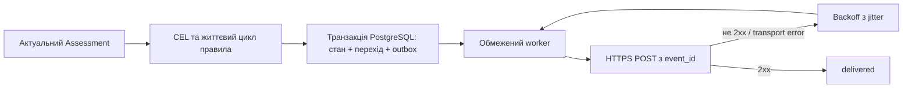

# Алерт і один HTTPS webhook

Мінімальний Controller приймає один `AlertRule` з явним `monitorRef` і
`scope: monitor` та один `WebhookEndpoint`. Поля взято з DSL §§13–14;
нових kind чи HTTP-маршрутів немає. Selector, zone scope, labels та
weightedScore у CEL цього профілю відхиляються, а не ігноруються.

## Шлях події



`normal → pending → firing → resolved`. До firing потрібна безперервна
істинна умова протягом `for`. CEL error/unknown, втрата актуальності,
зміна effective revision/правила або перезапуск скидає незавершений таймер.
У мінімальному Controller оцінювання відбувається раз на секунду; перерва
понад три секунди також скидає pending. Це консервативний локальний
критерій безперервності, не нове поле DSL.

Firing зберігається до `resolveWhen=true`: технічна втрата спостережень
не означає відновлення сервісу. Після resolved потрібне `when=false → true`;
false уже під час resolve достатньо для переозброєння. Unknown/error не
переозброює. Disabled правило не створює нових firing, але може завершити
наявний за явною умовою.

Cooldown застосовується окремо до firing і resolved того самого ключа.
Всі фактичні переходи записуються; придушене повідомлення не накопичується
для пізнішого replay. Час cooldown відраховується від останньої фактичної
постановки повідомлення цього типу в outbox. `notifyEvents: []` вимикає
повідомлення, зберігаючи життєвий цикл.

## Надійність і безпека

Стан, історія переходу й повідомлення записуються однією транзакцією.
Спроба резервується в PostgreSQL до HTTP POST; lease і номер спроби
зберігаються після рестарту. Успіх — тільки 2xx. Будь-яка інша відповідь
або транспортна помилка повторюється з exponential backoff та jitter у
межах `retry.maxAttempts`. Crash після резервування може витратити спробу
без фізичного запиту. Crash після приймання одержувачем може повторити
запит: одержувач мусить дедуплікувати стабільний UUID `event_id`.
Exactly-once доставка не обіцяється.

Локальна межа віку недоставленої події — 24 години, після чого вона
залишається failed для аналізу. Зміна нормалізованого endpoint скасовує
старі pending/leased повідомлення, щоб вони не пішли новому одержувачу.
Це обмеження мінімальної реалізації, а не додаткові YAML-поля. Автоматичного
retention історичних terminal rows поки немає; БД потребує резервних копій.

URL лише HTTPS з IP literal, явним `-webhook-allow-cidrs`; metadata,
link-local, unspecified і multicast заборонені. Hostname destinations цього
профілю ще не підтримані. TLS ≥1.3 перевіряється; додатковий CA задається
файлом. Redirect і успадкований proxy вимкнені. Bearer читається з приватного
regular file без symlink; значення не передається аргументом чи YAML.
Секрет оновлюється з перезапуском Controller. Raw response і транспортні
помилки з URL/токенами не записуються в payload/log/attempt audit.

`event_id`, тип, правило, Monitor, null zone, state, severity, reason codes,
evidence IDs, UTC час і schema_version відповідають DSL §14.1.
Alert state не підмінює Assessment, а помилка одержувача не означає відмову
контрольованого сервісу. `alert.json` і HTML показують стан правила й час
постановки в чергу; вони не видають enqueue за підтвердження доставки.

## Запуск

Параметри Controller:

```text
-alert-rule=/run/netmonorc/alert.yaml
-webhook-config=/run/netmonorc/webhook.yaml
-webhook-allow-cidrs=192.0.2.10/32
-webhook-secret-dir=/run/netmonorc/secrets
-webhook-ca=/run/netmonorc/ca.crt
-alert-file=/data/alert.json
```

Обидва YAML-файли потрібні разом. `monitorRef` має відповідати поточному
Monitor, `channelRef` — endpoint. Без цих прапорців алертинг не запускається.
Для bearer `secretRef` — ім'я файла в secret-dir з правами 0600.
Додатковий CA необов'язковий для публічно довіреного TLS-сертифіката.

Compose включає приватний дослідницький HTTPS-приймач, який не є частиною
production Controller. Його SQLite дедуплікує `event_id`; локальний mode
file дозволяє відмовити першим запитам. Немає публічного management API.
CA private key лишається на хості; runtime бачить лише свій cert/key.

```bash
docker compose build controller target
python3 scripts/lab.py prepare
python3 scripts/lab.py up
python3 scripts/lab_notifications.py --output .local/notifications.json
python3 scripts/lab.py export --output .local/lab-report
```

Скрипт перевіряє реальні 503→200 з тим самим event_id, firing під час втрати
Agent, explicit healthy→resolved, рестарт із недоставленою подією й durable
attempt audit. Результат одного прогону є інтеграційним свідченням, не
статистичною гарантією доступності зовнішнього одержувача.

## Перегляд фактичної доставки

HTML, який записує Controller, додатково читає PostgreSQL outbox в одному
SQL snapshot. Блок «Доставка сповіщень» показує pending/leased/delivered/
failed/cancelled та останню подію, кількість зарезервованих спроб і останній
HTTP status code. Нуль означає, що HTTP-відповідь не зафіксована; це не HTTP 0.
Delivered означає відповідь 2xx, а не гарантію подальшої обробки receiver.
Leased є резервуванням: crash до HTTP POST може залишити витрачену спробу.

Лічильники обмежені поточними endpoint hash, AlertRule та Monitor. Це не
глобальна статистика всіх попередніх каналів; заміна endpoint не переносить
старі події до нового. Порожня вибірка показує відсутність подій. Disabled
канал явно позначений. URL, token, raw payload/response у цей блок не входять.
Дані є знімком на вказаний час і можуть застаріти разом з HTML-файлом.

Read-only проєкція не змінює Alert/Assessment або delivery state й не додає
HTTP API routes чи DSL-полів. Controller може записувати цей snapshot за `-delivery-file`; Compose
записує `/data/delivery.json`. `lab.py export` включає його разом із HTML.
Локальний netmonorc-report відтворює блок через `-delivery delivery.json`
без доступу до БД. Без snapshot блок відсутній.
