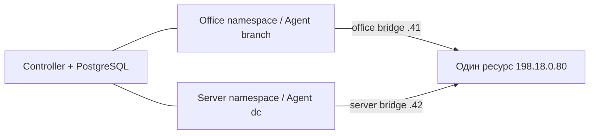

# Відтворюваний Compose-стенд

Потрібні Docker Engine з Compose v2, Python ≥3.10 та OpenSSL на машині
оператора. Go на хості не обов'язковий: застосунки збираються контейнером.
Образи Go 1.25.4, Python 3.12.12, Blackbox 0.27.0 та PostgreSQL 17.6
зафіксовані версіями й SHA256 digest. Це стенд мінімального прототипу.

## Запуск

```bash
docker compose build controller target
python3 scripts/lab.py prepare
python3 scripts/lab.py up --mode adaptive
python3 scripts/lab.py status
python3 scripts/lab.py export --output .local/lab-report
```

Після export відкрийте `.local/lab-report/report.html`. Це snapshot; повторний
export оновлює локальну копію. Порти на хост не публікуються. Controller
записує поточні JSON і HTML у свій приватний volume.

Якщо мережа збірки використовує корпоративний TLS proxy, передайте довірений
CA bundle через тимчасовий BuildKit secret:

```bash
NMO_BUILD_CA_FILE=/etc/ssl/certs/ca-certificates.crt docker compose -f compose.yaml -f deployment/build-ca.compose.yaml build controller target
```

TLS verification залишається ввімкненою. Build CA не додається до runtime
образу. Agent встановлює пряме mTLS-з'єднання, без успадкованого HTTP proxy.
Для цільових probes діють локальний allowlist, заборона redirects і TLS check.

`prepare` генерує приватні cert/key/пароль у `.local/lab/<project>` і передає
їх через stdin до окремих named volumes. Приватний ключ CA лишається на хості;
кожний Agent бачить тільки власний key/cert і публічний CA. Секрети не входять
до Docker image/build context і не передаються аргументами процесів.
PostgreSQL працює лише в control network; TLS до БД у цьому локальному
профілі не ввімкнено. Сертифікати дослідницькі, строк дії — 2 доби. Це не
реалізація enrollment/rotation чи production deployment.

Повторний prepare вимагає зупиненого стенда й зберігає пароль/ідентичності.
Без локального ownership marker наявні project volumes не перезаписуються.
Після expiry сертифікатів використайте новий project для нового стенда;
старі дані залишаються доступними у збережених volumes/експортах.

## Топологія



Control — окремий internal bridge. Office і server — різні непублічні
bridges без IP masquerading. Ресурс має один /32 VIP на loopback та по
інтерфейсу в обох сегментах. Agent routes ведуть до VIP через інтерфейс
цілі лише у своїй зоні. Для UDP DNS fixture прив'язаний до VIP, щоб відповідь
не отримувала іншу source IP на багатомережевому вузлі.

NET_ADMIN є лише у контейнерів підготовки мережевих namespace та target
fixture. Програмні Agent/Controller запускаються UID 10001, read-only root,
cap_drop ALL, no-new-privileges, з bounded memory/pids і приватним tmpfs.
Це логічно розділені мережеві шляхи на одному хості, не незалежне обладнання.
Хост, Docker daemon, target process і ресурси CPU залишаються спільними.

Інша інсталяція може використовувати свій project і приватний IP prefix:

```bash
python3 scripts/lab.py prepare --project thesis-demo --prefix 172.29
python3 scripts/lab.py up --project thesis-demo --prefix 172.29
```

Prefix задає мережі `<prefix>.40/41/42.0/24`. Якщо вони перетинаються з
іншими мережами, оберіть інший приватний prefix; наявні чужі мережі не змінюйте.
Для прямих Compose команд використовуйте відповідні `-p` і NMO_NET_PREFIX.

## Контрольовані відмови

```bash
python3 scripts/lab.py inject --scenario http
python3 scripts/lab.py inject --scenario dns
python3 scripts/lab.py inject --scenario tcp
python3 scripts/lab.py inject --scenario office-path
python3 scripts/lab.py inject --scenario healthy
```

HTTP повертає 503; DNS — NXDOMAIN; TCP listener 9090 закривається.
Office-path змінює тільки маршрут VIP в офісному namespace; control/mTLS
не розривається, серверна зона продовжує бачити ресурс. Очікується degraded
для зональної відмови й down для підтвердженої загальної required-відмови.
Ін'єкція multiple поєднує HTTP та DNS відмови для перевірки меж каталогу.
Мітка сценарію передається тільки fixture/маршруту, а не планувальнику.

Три режими використовують ті самі YAML action catalogs і бюджети. Static
обирається окремим comparison flag; нового mode в DSL немає.

```bash
python3 scripts/lab.py up --mode fixed
python3 scripts/lab.py up --mode static
```

Перед зміною mode поверніть healthy й дочекайтеся закриття incident.
Команда up вимагає свіжих healthy observations від обох Agent і відхиляє
запуск як готовий, якщо доступність цілі не підтверджена.

## Зупинка та дані

```bash
python3 scripts/lab.py down
```

Команда прибирає контейнери/мережі тільки цього project і зберігає named
volumes. Не використовуйте `down -v`, якщо потрібно зберегти PostgreSQL,
spool, конфігурацію та результати. Локальна PKI не замінює резервну копію БД.
Для діагностики: `docker compose logs controller branch dc target`,
`python3 scripts/lab.py status`. Скрипти не роздруковують DSN/паролі.

## Межі

Один Monitor, фіксований Agent на зону, заздалегідь видані сертифікати,
HTTP/TCP/UDP DNS у цьому стенді. ICMP перевірено окремим ізольованим smoke;
CAP_NET_RAW до програмних Agent цього стенда не додається. Немає повного
installer, публічного API/UI керування, HA, hostname targets чи універсальної
firewall-політики. Стенд слугує відтворенню методу та експериментів.
