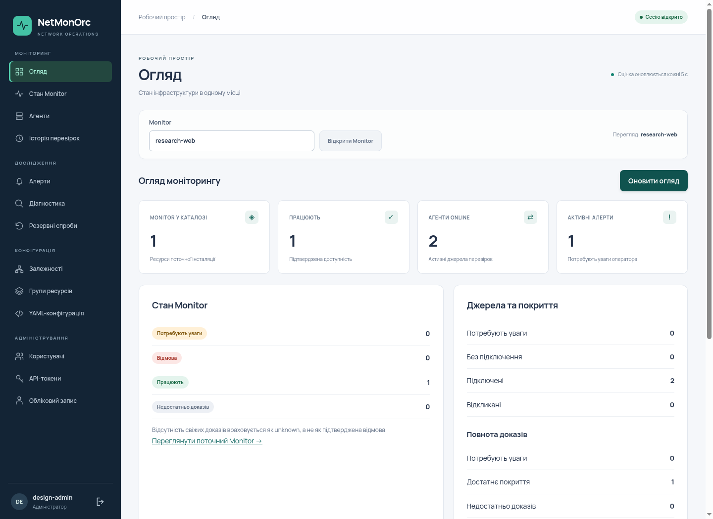
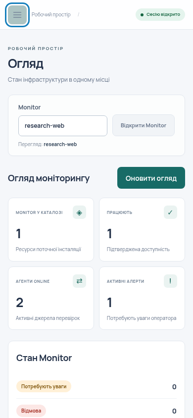

# Адмінка за евристиками Нільсена — 2026-11-25

Оновлено layout, бокову навігацію, локальний кириличний Manrope, адаптивність,
огляд, підтвердження дій, збереження YAML/batch drafts та зворотний зв’язок.
[Контракт і відповідність 10 евристикам](../../deployment/admin-ui.md).
Це реалізація евристик, а не usability study чи формальна сертифікація доступності.

## Реальний браузер

browser.json має status=passed: **97 дій, 62 унікальні назви контролів/навігації,
14 груп сценаріїв, 2 завантажені JSON-файли, 0 JavaScript runtime exceptions**.
Використано Chromium із pointer events, справжній HTTPS Controller/PostgreSQL,
два mTLS Agents, native/Blackbox probes та приватний HTTPS webhook fixture.
TLS verification увімкнена; публічний test CA додано лише в тимчасовий NSS profile.

Перевірено:

- усі 13 розділів навігації й локальне завантаження Manrope;
- огляд, Agent refresh, поточні оцінки та відкриття/закриття Observation;
- history older/newer pagination на реальних спостереженнях;
- збереження чернетки між розділами й відмова від discard;
- Target validate/plan/create/catalog/load/delete та cancel/accept підтвердження;
- відображення помилки некоректного YAML та повернення до чинного ресурсу;
- створення другого Monitor, перегляд його healthy оцінки, повернення до першого та видалення;
- prepare/validate/plan/apply пакета й читання операцій;
- граф, контекст Monitor, скидання фільтрів, вибір залежності й group assessment;
- список fallback runs (порожній у цьому сценарії);
- справжня completed діагностика, task/baseline evidence та обидва JSON downloads;
- ручний запуск slow-профілю та скасування running сесії;
- alert detail/ACK, webhook test/status та delivery list;
- створення/редагування/закриття/refresh користувача;
- видача PAT, приховування секрету, cancel/accept відкликання;
- зміна власного пароля, реальний reload і відновлення cookie-сесії;
- mobile 390×844, меню/Escape/повернення фокусу, відсутність body horizontal overflow;
- viewer login без Users/мутацій конфігурації, read-only editor, logout.

Initial button inventory окремо записує disabled controls. Пагінація решти
каталогів/сесій/доставок потребує більших datasets; fallback evidence — окремої
технічної помилки виконавця. Всі комбінації станів і клавіатурні траєкторії цим
запуском не вважаються перевіреними. Test users/resources належать тільки owned stand.

## Знайдені та виправлені проблеми

Controller раніше видавав лише JS/CSS: локальний шрифт отримував 404. Додано
обмежену видачу assets/*.ttf з font/ttf, правильні file permissions та перевірку,
що інші файли/ключі/traversal не відкриваються.

Після CRUD Monitor Controller перезапускає runtime/API. Prepare/validate/plan
тепер використовують обмежені повтори як немутуючі запити. У фінальному прогоні
зафіксовано 5 ERR_CONNECTION_CLOSED/RESET для validate, після яких запит успішний.
ERR_ABORTED у network trace включає зміну Monitor/закриття контексту та завершення
204; його не слід читати як доказ невдалого запису. Очікувані HTTP errors: 401
до входу, 400 для навмисно невалідного YAML, тимчасові 404 під час появи нового Monitor.

Мутації автоматично не повторюються. Окремий test_api_retry.mjs підтверджує
transport/503 recovery для read-only POST і рівно одну відправку ambiguous apply.
History refresh/пагінація одразу позначають busy та блокують застарілі row controls.
Після зміни пароля polling перевідкривається для нової cookie-сесії.

## Інші перевірки та артефакти

Frontend TypeScript/Vite, production Docker build, go test ./... та go vet ./...
пройшли; журнали наведені поруч. DSN-based Go tests без NETMONORC_TEST_DSN_FILE
пропущені; справжню БД перевіряє браузерний стенд. Новий Go regression test
перевіряє font MIME, disallowed file paths/methods та traversal.

runtime.json містить базовий commit, фактичний image ID і SHA-256 source files.
Desktop/mobile знімки переглянуто; вони не містять credentials чи PAT secrets:

Сервіси власного стенда зупинені; .local, PKI та named volumes збережені.
Віддалені сервери користувача не змінювались. Це один Docker host, не перевірка
зовнішньої мережі, HA або повної відповідності старому ТЗ.
