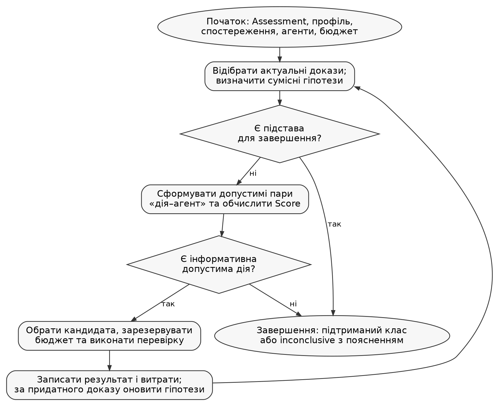
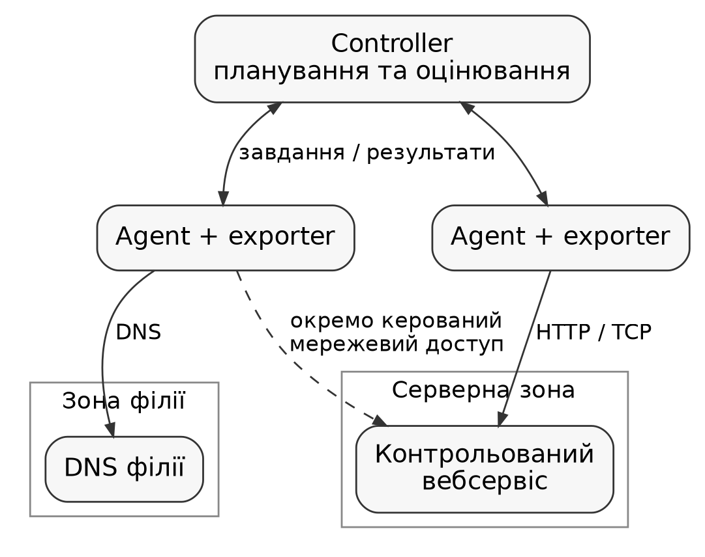

# 2.3 Розроблення алгоритму адаптивного виконання діагностичних перевірок

У підрозділі 2.2 було розглянуто алгоритм комплексного оцінювання стану мережевого ресурсу. Його результат показує, чи підтверджено працездатність сервісу, чи виявлено погіршення або відмову, а також чи достатньо наявних спостережень. Проте встановлення стану ще не пояснює, чому він виник. Наприклад, невдала HTTP-перевірка з віддаленої філії може бути пов’язана з помилкою DNS, недоступністю прикладного сервісу або обмеженням мережевого доступу саме з цієї філії. Для розмежування таких ситуацій потрібні додаткові відомості.

Найпростішим рішенням є запуск усіх передбачених діагностичних перевірок після кожного відхилення. Проте частина відповідей уже може бути відома, а різні перевірки потребують неоднакових витрат. Якщо проблема пояснюється помилкою DNS, звернення до всіх портів і з усіх зон можуть не додавати корисної інформації. За одночасних відмов багатьох ресурсів надлишкова діагностика також здатна заважати регулярному моніторингу.

Іншим поширеним підходом є заздалегідь визначена послідовність дій: спочатку перевірити DNS, потім TCP-з’єднання, після цього HTTP-відповідь. За потреби таку послідовність доповнюють умовними переходами. Вона є зрозумілою та придатною для типових випадків, але порядок перевірок залишається наперед заданим. Зміна доступності агентів або поява нового спостереження не обов’язково змінює наступний крок.

Для NetMonOrc пропонується адаптивний алгоритм, у якому наступна діагностична дія обирається після врахування вже отриманих результатів. Його основна ідея полягає в послідовному зменшенні кількості сумісних пояснень несправності. При цьому обирається не лише перевірка, а й агент, з якого її доцільно виконати. Це важливо для корпоративних мереж, де один ресурс може бути доступним із серверного сегмента й недоступним із віддаленого офісу.

Вхідними даними є актуальний результат оцінювання, придатні спостереження, каталог діагностичних дій, відомості про агентів та установлені обмеження. Виходом є підтриманий спостереженнями клас несправності або висновок про недостатність даних. Разом із результатом зберігаються виконані кроки та пояснення їх вибору. Діагностика доповнює оцінювання стану, але не підміняє його: припущення про причину не може самостійно перетворити `unknown` на підтверджену відмову.

<!-- PAGE -->

Для формального опису алгоритму введемо множину гіпотез. Під гіпотезою надалі розуміється заздалегідь описаний клас спостережуваної несправності, а не доведена фізична причина. Наприклад, «сервіс недоступний із філії» є обережнішим висновком, ніж «зламався маршрутизатор філії», оскільки однакові результати можуть бути спричинені маршрутизацією, фільтрацією або іншою залежністю.

Повний перелік гіпотез позначимо H, а перелік пояснень, сумісних із доказами після поточного кроку, — Hₜ.

Тут H — повний перелік дозволених класів, а Hₜ — ті з них, які залишаються сумісними з доказами після кроку t. Перелік формується у профілі діагностики до проведення експерименту. Його не можна підлаштовувати під відому досліднику несправність у конкретному запуску. Основні позначення наведено в таблиці 2.3.

Таблиця 2.3 — Позначення алгоритму адаптивної діагностики

| Позначення | Зміст |
|---|---|
| H, Hₜ | Повний і поточний набори гіпотез |
| D | Каталог додаткових перевірок |
| A | Відомі системі агенти |
| u = (d, a) | Кандидат: дія d на агенті a |
| Uₜ | Допустимі кандидати на поточному кроці |
| Sᵤ,ₕ | Множина результатів, сумісних із гіпотезою h |
| c(u) | Додатна умовна вартість дії |
| G(u ∣ Hₜ) | Кількість пар гіпотез, які розрізняє кандидат |

Множина кандидатів визначається не тільки наявністю потрібної перевірки в каталозі. Агент повинен підтримувати її тип, мати доступ до дозволеної цілі та належати до потрібної зони. Враховуються його доступність, зайнятість і можливість завершити дію в установлених межах. Узагальнено це подається так:

До поточного переліку кандидатів включаються лише ті пари «дія–агент», для яких виконуються всі умови допустимості.

Функція Allowed об’єднує перелічені перевірки допустимості. Наприклад, агент серверного сегмента не може замінити агента філії, якщо дія має перевірити доступність саме з філії. Так само відсутність вільного виконавця не є доказом відмови ресурсу. Якщо допустимих кандидатів немає, алгоритм завершується з поясненням, що діагностику не вдалося продовжити за наявних умов.

<!-- PAGE -->

Для кожної дії у профілі задаються очікувані результати за різних гіпотез. Вони є експертним описом поведінки, а не статистично визначеними ймовірностями. Розглядаються значення `success`, `failure`, `unknown` та `either`. Перші два означають придатний позитивний або негативний результат. Значення `unknown` описує відсутність придатного висновку за умовами моделі, а `either` дозволяє будь-який із трьох результатів і не створює розрізнення само по собі.

Для кожної пари «дія–гіпотеза» задається перелік допустимих результатів: успіх, відмова або невизначеність.

Для конкретного очікуваного результату множина S містить один елемент, для `either` — усі три. Якщо перебіг дії за певної несправності нестабільний або недостатньо відомий, безпечніше залишити ширше очікування, ніж описувати невиправдано точний результат. Водночас надмірна кількість `either` зменшує можливість розрізняти гіпотези.

Перед початком додаткових запусків алгоритм перевіряє наявні спостереження. Використовуються лише актуальні докази чинної ефективної ревізії. Збіг назви перевірки недостатній: повинні відповідати її параметри, засіб виконання, ціль і дозволена зона. Наприклад, успішна TCP-перевірка з дата-центру не замінює таку саму перевірку з офісу. Якщо відповідність не встановлена, результат не застосовується для початкового відсіювання гіпотез.

Після отримання придатного результату yₜ від обраного кандидата поточна множина оновлюється:

Після кожного придатного результату залишаються лише гіпотези, очікування яких допускають отриманий результат.

Таким чином, залишаються лише пояснення, які не суперечать новому доказу. Відсутність відповіді від засобу виконання має інше значення, ніж негативний результат цільового запиту. Цю відмінність наведено в таблиці 2.4.

Таблиця 2.4 — Вплив результатів на діагностичний висновок

| Подія | Як враховується |
|---|---|
| Виконаний запит підтвердив успіх або відмову | Зіставляється з очікуваннями гіпотез |
| Перевірка не запустилась, exporter недоступний | Не доводить сервісну гіпотезу; фіксується технічна помилка |
| Доказ застарів або належить іншій ревізії | Не використовується для поточного звуження |
| Жодна гіпотеза не сумісна з доказами | Повертається inconclusive із поясненням конфлікту |

<!-- PAGE -->

Наступним питанням є вибір дії, яку варто виконати першою. Для цього оцінюється її здатність розрізняти гіпотези, що залишились. Якщо для двох гіпотез очікувані результати не перетинаються, то придатне спостереження дозволяє розмежувати цю пару. Якщо ж існує спільний допустимий результат, однозначне розрізнення не гарантується.

$$
G = \text{кількість пар гіпотез, які розрізняє перевірка}. \tag{2.5}
$$

Корисність G показує, скільки пар поточних гіпотез розрізняє перевірка. Для остаточного вибору її ділять на умовну вартість c:

$$
\mathrm{Score} = \frac{G}{c}. \tag{2.6}
$$

Вартість c(u) задається параметром costUnits відповідної дії. Це відносна оцінка витрат: складніша перевірка може мати більшу ціну, ніж короткий DNS-запит. Для однакової дії на рівноцінних виконавцях застосовується одна шкала вартості.

Розглянемо три гіпотези: h₁ — помилка DNS у філії; h₂ — відмова вебзастосунку; h₃ — недоступність сервісу з філії за його доступності із серверного сегмента. Їх очікування наведено в таблиці 2.5. Звернення за IP не залежать від перевірюваного DNS; для HTTPS при цьому має зберігатися коректна перевірка імені та сертифіката.

Таблиця 2.5 — Приклад каталогу дій та їх початкових оцінок

| Дія і точка виконання | h₁ | h₂ | h₃ | c | G | Score |
|---|---|---|---|---|---|---|
| d₁: DNS із філії | F | S | S | 1 | 2 | 2 |
| d₂: HTTP за IP із серверного сегмента | S | F | S | 1 | 2 | 2 |
| d₃: TCP за IP із філії | S | E | F | 1 | 1 | 1 |
| d₄: HTTP за IP із філії | S | F | F | 2 | 2 | 1 |

У таблиці S означає success, F — failure, E — either. Для h₂ TCP може залишатись доступним навіть за несправного застосунку, тому його результат не задається однозначно. За рівної оцінки між діями використовується порядок їх ідентифікаторів. Якщо одна дія має кількох рівноцінних виконавців, вибір агента визначається політикою розміщення; це не змінює формулу Score.

<!-- PAGE -->

Розглянемо послідовність роботи алгоритму для випадку, коли регулярна HTTP-перевірка за доменним іменем із філії завершилась негативно. У прикладі припускається одна стабільна несправність із трьох описаних класів. Початкова подія сумісна з кожним із них, тому сама по собі не дає підстав відкинути жодну гіпотезу. Каталог додаткових дій відповідає таблиці 2.5, а ціна всіх дій зафіксована до запуску.

На першому кроці найвищу оцінку мають d₁ і d₂. За прийнятим порядком ідентифікаторів обирається DNS-перевірка d₁. Вона розрізняє пари h₁–h₂ та h₁–h₃, але не розмежовує h₂ і h₃. Саме тому її G дорівнює двом. Якщо DNS повертає придатний негативний результат, залишається h₁. Це підтримує висновок про клас DNS-несправності в межах моделі, але не доводить конкретну помилку конфігурації сервера.

Для іншої гілки припустимо, що d₁ завершилась успішно. Тоді залишаються h₂ і h₃. Оцінки потрібно обчислити повторно: попереднє значення G вже не відповідає новій множині. Перевірка d₂ розрізняє єдину пару, оскільки за h₂ очікується failure, а за h₃ — success. Для d₃ перетинаються множини either і failure, тому G дорівнює нулю. Для d₄ обидві гіпотези очікують failure, отже її G також дорівнює нулю.

Таблиця 2.6 — Приклад послідовного звуження гіпотез

| Крок | Доказ або дія | Результат | Сумісні гіпотези |
|---|---|---|---|
| Початок | HTTP за ім’ям із філії | failure | h₁, h₂, h₃ |
| 1 | d₁: DNS із філії | success | h₂, h₃ |
| 2 | d₂: HTTP за IP із серверного сегмента | success | h₃ |

У наведеній гілці виконано два додаткові фізичні запуски. Висновок формулюється як підтримана доказами недоступність сервісу з філії за доступності з серверного сегмента. Стверджувати про несправність певного маршрутизатора за цими даними не можна. Якщо d₂ дала б failure, залишилась би гіпотеза відмови застосунку. Якщо ж перевірка не запустилася через недоступність exporter, множина h₂, h₃ не звузилась би.

Приклад демонструє зміну порядку дій залежно від відповідей. Він не є експериментальним доказом прискорення: реальний час залежить від затримок, таймаутів і паралельності. Крім того, за множинної або змінної несправності наведена таблиця може перестати відповідати спостереженням. У такій ситуації потрібен висновок про невизначеність, а не примусове призначення одного з трьох класів.

Обчислення оцінки для такого каталогу можна виконати без імовірнісних припущень, як показано в алгоритмі 2.1. Кожна неупорядкована пара враховується лише один раз.

Алгоритм 2.1 — Обчислення корисності кандидата

```text
SCORE(u, H):
    gain := 0
    for кожна пара (hp, hq) із H, де p < q:
        if очікування[u, hp] ∩ очікування[u, hq] порожній:
            gain := gain + 1
    return gain / costUnits[u]
```

<!-- PAGE -->

Узагальнену схему адаптивної діагностики наведено на рисунку 2.2. Спочатку створюється діагностична сесія та відбираються придатні початкові докази. Далі алгоритм перевіряє можливість завершення, формує допустимих кандидатів і обирає наступну дію. Після її виконання результати зберігаються, а множина гіпотез та доступний бюджет переглядаються.



Під «достатнім висновком» на схемі розуміється не лише отримання одного елемента Hₜ. Потрібно також мати придатний доказ, що відповідає конкретному очікуванню цього класу, та виконати задані умови підтвердження. Якщо профіль від початку містив лише одну гіпотезу, її наявність без результатів перевірок не доводить несправність.

Схема передбачає окрему гілку для технічних помилок. Витрати на невдалий запуск не зникають, але його результат не використовується як доказ відмови сервісу. Якщо відсутні інформативні допустимі дії, завершення з `inconclusive` є коректним результатом. Воно означає, що поточних перевірок, виконавців або доказів недостатньо для обґрунтованого висновку.

<!-- PAGE -->

Псевдокод основного циклу подано в алгоритмі 2.2. Допоміжні процедури приховують технічні операції, але не змінюють послідовності прийняття рішення. Зокрема, процедура підтвердження не обирає довільні дії: вона виконує лише передбачені профілем перевірки в межах того самого бюджету.

Алгоритм 2.2 — Адаптивне виконання діагностичних перевірок

```text
ADAPTIVE(profile, assessment, observations, agents):
    E := придатні докази чинної ревізії
    H := гіпотези profile, сумісні з E
    B := залишок бюджету поточного епізоду
    R := журнал уже виконаних дій
    while true:
        B := актуальний залишок бюджету епізоду
        оновити придатність E; перебудувати H за чинними E
        if H порожня:
            return INCONCLUSIVE("конфлікт доказів", E)
        if |H| = 1:
            return ЗАВЕРШИТИ_АБО_ПІДТВЕРДИТИ(H, E, B)
        if сплив час або сесію скасовано:
            return INCONCLUSIVE("межа виконання", H, E)
        U := допустимі пари (дія, агент) за E, B, R
        for u in U:
            score[u] := кількість розрізнюваних пар / ціна
        if U порожня або max(score) = 0:
            return INCONCLUSIVE("немає інформативної дії", H, E)
        u := кандидат із найбільшим score
             із погодженим вирішенням рівності
        if атомарно зарезервувати бюджет для u не вдалося:
            continue
        result := виконати u до спільного deadline
        записати запуск, витрати та result у R
        if result є придатним доказом чинної ревізії:
            додати result до E
            H := {h із H: result сумісний з h}
        else:
            зберегти причину без відсіювання гіпотез
```

Цей варіант описує базовий послідовний режим без додаткових кроків із нульовою корисністю. Явно дозволені повтори та підтвердження обробляються окремо. Сама поява чергової ітерації не дозволяє повторно запускати ту саму дію. Для цього потрібні нові значущі докази або відповідний дозвіл профілю.

Бюджет резервується до передавання завдання агенту. Це необхідно, щоб два одночасні рішення не використали один і той самий залишок. Резервування не замінює фактичного обліку запусків, а запізнілий результат перевіряється на придатність перед його використанням. Для порівняння режимів у стенді доцільно спочатку застосувати один одночасний діагностичний запуск. Так зменшується вплив різного порядку надходження відповідей на пояснення вибору.

<!-- PAGE -->

Окремою частиною алгоритму є контроль витрат. Адаптивність не повинна означати необмежене продовження перевірок. Для діагностичного епізоду задаються максимальна кількість додаткових фізичних запусків, загальна тривалість і паралельність. За потреби вводиться також обмеження на оцінений обсяг трафіку. Перед запуском перевіряється виконання таких умов:

Новий запуск дозволяється, якщо після його врахування не буде перевищено кількість перевірок, загальний час і допустиму паралельність.

Для цього враховуються вже використані запуски, час від початку епізоду та кількість одночасних дій. Перед призначенням нового завдання резервуються потрібні ресурси. Очікувана тривалість не замінює жорстку часову межу: завдання повинно мати власний таймаут і спільний кінцевий строк сесії.

Якщо задане обмеження трафіку, оцінений обсяг нового запиту разом із уже врахованими витратами має вкладатися в установлену межу. Умовна вартість кожної дії повинна бути більшою за нуль.

Умова щодо обсягу трафіку застосовується лише за наявності відповідного обмеження. Оцінений трафік не слід видавати за виміряний. Так само не можна без нормування додавати секунди, кількість запитів і байти до одного показника. Умовна ціна використовується для ранжування, тоді як кількість запусків, час і паралельність контролюються окремо.

Якщо одна дія має кілька виконавців, кожна фізична перевірка враховується окремо. Наприклад, за межі у чотири запуски після двох уже використаних спроб не можна призначити дію одразу трьом агентам. У базовому прикладі кожна дія має одного виконавця, що спрощує облік і порівняння результатів. Повтор після технічної помилки та перевірка для підтвердження також витрачають бюджет.

Переривання зв’язку з агентом не повинно автоматично скасовувати вже враховану спробу: запит міг бути виконаний, хоча відповідь не надійшла. Повторна доставка того самого результату, навпаки, не є новим запуском. Для розрізнення цих випадків потрібні сталі ідентифікатори завдання, спроби та спостереження.

Регулярний моніторинг і діагностика мають розділяти доступну місткість агентів. Додаткові запити не повинні зайняти всі робочі місця й зупинити отримання основних спостережень. Інакше сама діагностика спричинить втрату покриття, намагаючись пояснити початкову проблему.

<!-- PAGE -->

Важливим обмеженням запропонованого підходу є мінливість мережевого середовища. Якщо один запит завершився відмовою, а наступний — успіхом, це може свідчити про короткочасне відхилення, балансування або відновлення сервісу. Тому алгоритм не повинен накопичувати висновки без повторної перевірки придатності доказів. Після завершення TTL, зміни ефективної ревізії чи порушення часового узгодження робочий набір доказів переглядається. Відкинуті раніше гіпотези можуть знову стати сумісними, але витрачений бюджет від цього не відновлюється.

За потреби профіль містить явні умови підтвердження. Вони задають дозволені дії, мінімальну кількість придатних спостережень, мінімальну кількість відомих різних доменів відмови та інтервал між результатами. Кількість спостережень включає первинний доказ, якщо він відповідає умовам. Стисло перевірку можна подати так:

Для підтвердження перевіряються три умови: достатня кількість придатних спостережень, потрібна кількість відомих різних доменів відмови та дотримання інтервалів між підтвердженнями.

Для підтвердження беруться лише придатні докази з відомим походженням. Інтервали перевіряються між відповідними підтвердженнями, а не як середній час усіх повідомлень. Невідомий домен не можна рахувати як нове незалежне джерело. Навіть різні домени відмови є практичним наближенням незалежності, а не математичним доведенням її відсутності між усіма мережевими залежностями.

Наприклад, два агенти на різних серверах можуть використовувати один шлюз. Їхні одночасні відмови не дають такого самого підтвердження, як результати з двох справді різних мережевих шляхів. Повтор із того самого агента через певний час допомагає перевірити стійкість прояву, проте сам по собі не створює другого домену відмови.

Якщо stopWhenUnique дозволяє раннє завершення, один підтриманий клас може завершити сесію за достатніх доказів. Якщо раннє завершення вимкнено, після отримання одного класу виконуються лише передбачені підтвердження. За неможливості виконати їх у межах бюджету результат залишається `inconclusive`. Технічний retry дозволяється лише явно й не використовується для повторення негативних відповідей доти, доки не з’явиться бажаний успіх.

Бюджет прив’язується до епізоду відхилення. Перепідключення агента, нові спостереження, зміна ревізії та скасування сесії не створюють його заново. Межа такого епізоду — актуальне повернення до healthy з повним покриттям. Діагностика забороняється також для ручного запуску, якщо вона вимкнена в Monitor. Ці правила запобігають обходу обмежень повторними стартами.

<!-- PAGE -->

Для оцінювання доцільності алгоритму потрібне порівняння з простішими способами виконання діагностики. У дослідженні передбачаються статичний режим, фіксований сценарій і адаптивний режим. Відмінності між ними наведено в таблиці 2.7. Усі вони повинні використовувати один доступний каталог дій, однакові можливості агентів і порівнювані бюджети. Висновки формуються за спільними правилами сумісності та підтвердження.

Таблиця 2.7 — Способи організації діагностичних перевірок

| Ознака | Статичний | Фіксований | Адаптивний |
|---|---|---|---|
| Порядок дій | Визначений набір | Заданий граф залежностей та умов | Перераховується за доказами |
| Вибір наступного кроку | За планом | За готовністю й умовою кроку | За розрізненням гіпотез на одиницю ціни |
| Припинення зайвих дій | Не є основним правилом | Через задані умови | Після достатнього висновку або втрати корисних дій |
| Основне обмеження | Можливі надлишкові запуски | Потрібно наперед описати гілки | Потрібна коректна таблиця очікувань |

Фіксований сценарій може мати умовні переходи й завершуватися рано, тому його не слід навмисно робити гіршим для порівняння. Статичний набір у межах бюджету також може виконуватись паралельно, якщо це дозволено однаково для всіх режимів. На рисунку 2.3 показано мінімальний стенд, де перевіряється вплив точки спостереження.



На стенді незалежно відтворюються відмова застосунку, помилка DNS, закриття TCP-порту, блокування доступу з філії та втрата агента. Справжній внесений збій записується засобом експерименту, але не передається алгоритму як вхідна підказка. Для кожного режиму зберігаються правильність висновку, кількість додаткових запусків, час діагностики та частка невизначених результатів.

Повертаючись до таблиці 2.5, статичний запуск чотирьох дій потребував би чотирьох фізичних перевірок, а наведена адаптивна гілка — двох. Це розрахунок для конкретного прикладу, а не результат вимірювання. В інших ситуаціях добре побудований фіксований сценарій може бути не гіршим, а паралельний статичний запуск — швидшим за послідовну діагностику. Саме тому окремо порівнюються час і витрати, а не лише один узагальнений показник.

<!-- PAGE -->

Запропонований алгоритм є послідовним вибором найкориснішої допустимої дії на поточному кроці. Він не перебирає всі можливі майбутні послідовності й не гарантує найменшої сумарної вартості для кожної несправності. Такий компроміс обрано свідомо: для прототипу важливі зрозумілість рішення, відтворюваність і помірна складність реалізації. Повне планування всіх гілок потребувало б складнішої моделі та додаткових припущень про результати.

Якщо m — кількість поточних гіпотез, k — кількість дій, а a — кількість агентів, пряма оцінка всіх пар гіпотез для всіх кандидатів має складність:

Час вибору зростає пропорційно кількості дій і агентів та кількості пар гіпотез, які потрібно порівняти.

Це оцінка одного вибору, а не часу всієї діагностики. Для невеликого каталогу вона є прийнятною порівняно з тривалістю мережевих таймаутів. Очікування для незмінних дій можна підготувати заздалегідь, а агентів відфільтровувати до оцінювання пар.

Алгоритм передбачається окремим модулем Controller, який працює з уніфікованими спостереженнями. Agent виконує призначену дію та передає результат. Контроль дозволених цілей, перенаправлень і ресурсів залишається обов’язковим незалежно від Score.

Журнал сесії має містити початкові гіпотези, докази, оцінки кандидатів, обрані дії та агентів, спроби й причину завершення. Це дозволяє відтворити рішення та виявити необґрунтоване відсіювання гіпотез. Кінцевий висновок супроводжується посиланнями на докази.

Основним обмеженням методу є залежність від якості початкового каталогу. Неповні або надто жорсткі очікування можуть призвести до конфлікту чи помилкового звуження. Значення `either`, явне підтвердження та результат `inconclusive` допомагають обережно працювати з цим обмеженням, але не усувають потреби перевіряти профілі на стенді. Кілька одночасних несправностей не слід примусово зводити до однієї.

Розроблений алгоритм поєднує вибір перевірки й виконавця з контролем доказів та витрат. Разом з оцінюванням стану він формує основу узагальненого методу комплексного моніторингу, розглянутого в наступному підрозділі.
